# Plataforma de Torneos y Clínicas de Hockey

Proyecto final de Backend II (Coderhouse). API REST para gestionar torneos y clínicas de hockey sobre césped: usuarios, eventos, categorías e inscripciones.

Esta versión corresponde a la **Pre-entrega 7**: suma el **flujo de inscripciones con tickets**. Un usuario autenticado se inscribe a un evento publicado, el backend controla **cupos** (solo cuentan los tickets activos), evita **inscripciones duplicadas**, permite **cancelar** sin borrar el ticket (el lugar se libera solo) y envía un **email de confirmación con Nodemailer**. Los eventos mantienen su ciclo de vida, filtros y paginación de la Pre-entrega 6, y los permisos siguen centralizados en middlewares de autorización.

## Versiones por entrega

Cada pre-entrega quedó en su propia rama, así se puede revisar el código tal como estaba en cada etapa. Cada rama incluye todo lo de las anteriores.

| Entrega | Rama | Qué suma |
| --- | --- | --- |
| Pre-entrega 1 | [`pre-entrega-1`](https://github.com/RaulAlvarezV/be2_proyecto_final/tree/pre-entrega-1) | Estructura base por capas (routes, controllers, services, repositories, DAO, models) |
| Pre-entrega 2 | [`pre-entrega-2`](https://github.com/RaulAlvarezV/be2_proyecto_final/tree/pre-entrega-2) | Registro seguro de usuarios con bcrypt, modelos Category y Registration |
| Pre-entrega 3 | [`pre-entrega-3`](https://github.com/RaulAlvarezV/be2_proyecto_final/tree/pre-entrega-3) | Login con JWT en la cookie `currentUser`, ruta `/current`, logout y tests automatizados |
| Pre-entrega 4 | [`pre-entrega-4`](https://github.com/RaulAlvarezV/be2_proyecto_final/tree/pre-entrega-4) | Autenticación centralizada en estrategias de Passport (register, login, current) |
| Pre-entrega 5 | [`pre-entrega-5`](https://github.com/RaulAlvarezV/be2_proyecto_final/tree/pre-entrega-5) | Roles y autorización: matriz de permisos, `authorizeRoles`, propiedad de eventos y rutas de administración |
| Pre-entrega 6 | [`pre-entrega-6`](https://github.com/RaulAlvarezV/be2_proyecto_final/tree/pre-entrega-6) | Entidad Event con estados, reglas de negocio en el service, filtros, paginación, orden y categorías |
| Pre-entrega 7 | [`pre-entrega-7`](https://github.com/RaulAlvarezV/be2_proyecto_final/tree/pre-entrega-7) | Tickets: inscripción con control de cupos, duplicados, cancelaciones, inscriptos por evento y email con Nodemailer |

Las capturas de cada entrega están en la sección [Evidencias](#evidencias).

## Temática

La plataforma permite que clubes y entrenadores publiquen **torneos** y **clínicas técnicas** de hockey, y que los jugadores se inscriban.

| Rol | Quién es | Qué va a poder hacer |
| --- | --- | --- |
| `admin` | Administración de la plataforma | Gestionar usuarios, categorías, eventos e inscripciones |
| `organizer` | Club, entrenador o academia | Crear y administrar sus torneos y clínicas |
| `user` | Jugador o jugadora | Consultar eventos e inscribirse |

Todo usuario nuevo se registra con rol `user`. El rol nunca se toma del body del registro.

### Entidades

| Modelo | Qué representa |
| --- | --- |
| `User` | Usuario de la plataforma: `first_name`, `last_name`, `email` (único), `password` (hash) y `role` (`user` por defecto; `user`, `organizer` o `admin`) |
| `Event` | Torneo, clínica o workshop: `title`, `description`, `category` (referencia), `date`, `location`, `capacity`, `price`, `status` y `organizer` (referencia al `User` que lo creó). Ver [Eventos](#eventos) |
| `Category` | Tipo de evento (por ejemplo `torneo`, `clinica`, `workshop`). El nombre es único y se guarda en minúsculas |
| `Ticket` | Inscripción de un usuario a un evento: referencias a `user` y `event`, `status`, `quantity`, `reservationCode`, `createdAt` y `cancelledAt`. Ver [Tickets e inscripciones](#tickets-e-inscripciones). (Reemplaza al modelo `Registration` de las primeras entregas) |

## Tecnologías

- Node.js y Express
- MongoDB + Mongoose (local o MongoDB Atlas)
- dotenv
- bcrypt (hash de contraseñas)
- jsonwebtoken (JWT)
- cookie-parser (lectura de la cookie de autenticación)
- Passport.js: `passport`, `passport-local` (registro y login) y `passport-jwt` (usuario actual)
- Nodemailer (email de confirmación de inscripción)
- node:test (tests automatizados, incluido en Node)
- Módulos ESM (`import` / `export`)

## Eventos

### Modelo

| Campo | Tipo | Reglas |
| --- | --- | --- |
| `title` | String | Obligatorio |
| `description` | String | Obligatorio |
| `category` | ObjectId → `Category` | Obligatorio. En el body se puede mandar el **id** o el **nombre** de la categoría (`"workshop"`); se guarda la referencia |
| `date` | Date | Obligatorio. **Futura** al crear y al editar |
| `location` | String | Obligatorio |
| `capacity` | Number | Obligatorio. Entero **mayor a 0** |
| `price` | Number | Opcional (por defecto `0`, evento gratuito). **No negativo** |
| `status` | String | `draft`, `published`, `cancelled` o `finished`. Todo evento nace `draft` |
| `organizer` | ObjectId → `User` | Se asigna solo desde `req.user` al crear; **nunca** se toma del body. Es una referencia, no el usuario embebido |

### Estados

| Estado | Significa | Visible en las rutas públicas |
| --- | --- | --- |
| `draft` | Creado pero todavía no publicado | No |
| `published` | Publicado y disponible | Sí |
| `cancelled` | Cancelado. **No se borra** de la base: se conserva el historial | Sí |
| `finished` | Ya ocurrió | Sí |

Cambios de estado permitidos con `PATCH /api/events/:id/status` (tabla `STATUS_TRANSITIONS` en `src/config/event-status.js`):

| Desde | Puede pasar a |
| --- | --- |
| `draft` | `published` (si la fecha todavía no pasó) o `cancelled` |
| `published` | `cancelled` |
| `cancelled` | Ninguno: es un estado final |
| `finished` | Ninguno: es un estado final |

`finished` no se elige a mano: un evento `published` cuya fecha ya pasó se marca como `finished` automáticamente antes de cada consulta (y las reglas lo tratan como finalizado aunque la base todavía no se haya actualizado).

### Reglas de negocio

Están en **`src/services/events.service.js`**, no en las rutas ni en los controllers. El modelo de Mongoose define la forma del dato y el service decide qué acciones tienen sentido.

| Regla | Respuesta |
| --- | --- |
| No se crea ni se edita un evento con fecha pasada | `400` "La fecha del evento debe ser futura" |
| `capacity` tiene que ser un entero mayor a 0 | `400` "La capacidad debe ser un número entero mayor a cero" |
| `price` no puede ser negativo | `400` "El precio no puede ser negativo" |
| Faltan campos obligatorios | `400` "Faltan campos obligatorios: ..." (con la lista) |
| La categoría tiene que existir | `400` "La categoría no existe" |
| Un evento **cancelado** no se modifica ni cambia de estado | `409` |
| Un evento **finalizado** no se modifica ni cambia de estado | `409` |
| No se publica un evento cuya fecha ya pasó | `400` |
| `organizer` y `status` del body se ignoran al crear y editar | El estado solo cambia con `PATCH /:id/status` |
| `capacity` no puede quedar por debajo de los lugares ya reservados | `409` "La capacidad no puede ser menor a los lugares ya reservados (N)" |
| Al **cancelar** un evento se cancelan sus tickets activos | No quedan inscripciones activas a un evento cancelado |

### Filtros, paginación y orden

`GET /api/events` acepta estos query params (todos opcionales y combinables):

| Param | Ejemplo | Qué hace |
| --- | --- | --- |
| `status` | `published` | Filtra por estado (`published`, `cancelled`, `finished`). Sin este filtro se listan todos menos los borradores |
| `category` | `workshop` | Filtra por categoría, por nombre o por id. Una categoría que no existe devuelve una lista vacía |
| `location` | `rosario` | Coincidencia parcial y sin distinguir mayúsculas |
| `dateFrom` | `2026-11-01` | Eventos desde esa fecha |
| `dateTo` | `2026-11-30` | Eventos hasta esa fecha (con solo el día, incluye todo ese día) |
| `page` | `2` | Página (por defecto `1`) |
| `limit` | `5` | Resultados por página (por defecto `10`, **máximo 50**) |
| `sort` | `-date` | Orden por `date`, `price`, `capacity`, `title` o `createdAt`; con `-` adelante es descendente (por defecto `date`) |

Un valor inválido (`page=0`, `sort=password`, `status=archivado`, una fecha que no es fecha, `dateFrom` posterior a `dateTo`) responde `400` con un mensaje que indica cuál es el problema.

Ejemplo: `GET /api/events?status=published&category=workshop&page=2&limit=5`

```json
{
  "status": "success",
  "data": [ { "id": "6690...", "title": "Workshop de arqueras", "category": { "id": "668f...", "name": "workshop" }, "organizer": { "id": "665f...", "first_name": "Raul", "last_name": "Alvarez" }, "status": "published", "...": "..." } ],
  "page": 2,
  "limit": 5,
  "total": 12,
  "totalPages": 3
}
```

Del organizador solo se muestra el nombre (las rutas de eventos son públicas, el email no se expone).

## Tickets e inscripciones

### Modelo `Ticket`

| Campo | Tipo | Reglas |
| --- | --- | --- |
| `user` | ObjectId → `User` | Sale de la sesión (`req.user`), **nunca** del body. Solo la referencia |
| `event` | ObjectId → `Event` | Sale de la URL (`/api/events/:eid/tickets`). Solo la referencia |
| `status` | String | `confirmed`, `pending` o `cancelled` |
| `quantity` | Number | Lugares que reserva. Entero mayor a 0 (por defecto `1`) |
| `reservationCode` | String | Código único de reserva (ej. `HKY-8F3A2C1D`), para identificar la inscripción sin exponer el id de MongoDB |
| `createdAt` | Date | Cuándo se hizo la inscripción (`timestamps`) |
| `cancelledAt` | Date | Cuándo se canceló (`null` mientras está activo) |

El modelo tiene un **índice único parcial** `{ user, event }` que solo aplica a los tickets activos: es el segundo control contra duplicados (el primero está en el service) y permite volver a inscribirse después de cancelar.

### Estados del ticket

| Estado | Significa | ¿Ocupa cupo? |
| --- | --- | --- |
| `confirmed` | Inscripción confirmada (es el estado con el que se crea) | Sí |
| `pending` | Lugar reservado a la espera de una confirmación (queda definido para un flujo con pago) | Sí |
| `cancelled` | Inscripción cancelada. El ticket **no se borra**: queda el historial con `cancelledAt` | No |

`confirmed` y `pending` son los estados **activos** (`ACTIVE_TICKET_STATUS` en `src/config/ticket-status.js`).

### Flujo de inscripción

`POST /api/events/:eid/tickets` → `auth` (401 sin sesión) → `tickets.controller` → **`tickets.service`**, que valida en este orden:

1. `quantity` es un entero mayor a 0 → si no, `400`.
2. El evento existe (un borrador cuenta como inexistente) → si no, `404`.
3. El evento no está cancelado ni finalizado (también cuenta como finalizado uno publicado cuya fecha ya pasó) → si no, `409`.
4. El usuario no tiene ya un ticket activo para ese evento → si no, `409` "Ya tenés una inscripción activa para este evento".
5. Hay cupo suficiente → si no, `409` "No hay cupos suficientes: quedan N lugares disponibles".
6. Se crea el ticket `confirmed` con su código de reserva.
7. Se envía el email de confirmación.

### Regla de cupos

```
lugares disponibles = capacity del evento − suma de quantity de los tickets activos (confirmed + pending)
```

La suma se hace con un `aggregate` en MongoDB. Los tickets `cancelled` no se cuentan, así que **al cancelar un ticket el lugar se libera solo**, sin tocar el evento. El evento no guarda un contador de inscriptos que pueda quedar desactualizado.

### Cancelación

`PATCH /api/tickets/:tid/cancel` cambia `status` a `cancelled` y registra `cancelledAt`. Lo puede hacer el dueño del ticket o un `admin` (middleware `authorizeTicketOwnerOrAdmin`). No se cancela un ticket ya cancelado (`409`) ni uno de un evento finalizado (`409`).

### Email de confirmación

Al confirmar una inscripción, **Nodemailer** envía un email al usuario con el evento, la fecha, el lugar, los lugares reservados y el código de reserva. Las credenciales salen de las variables `MAIL_*` del `.env` (ver [Variables de entorno](#variables-de-entorno)), nunca del código.

- La operación principal es el ticket: **si el email falla, la inscripción igual queda hecha**. El error se registra en la consola del servidor y la respuesta lo indica con `emailSent: false`.
- Si las variables `MAIL_*` no están configuradas, el servidor arranca igual (avisa por consola) y no intenta enviar.
- Los datos del evento se escapan antes de armar el HTML del email.

## Roles y autorización

### Roles

| Rol | En la plataforma | Cómo se obtiene |
| --- | --- | --- |
| `user` | Jugador o jugadora | Por defecto en todo registro. El registro público **nunca** acepta `role` del body |
| `organizer` | Club, entrenador o academia | Lo asigna un `admin` con `PATCH /api/users/:uid/role` |
| `admin` | Administración de la plataforma | El primero se asigna a mano en la base (ver abajo); después, otro admin con la misma ruta |

Los roles y la matriz están definidos en **`src/config/permissions.js`** (congelados con `Object.freeze`), y el modelo `User` toma de ahí el `enum` y el valor por defecto.

### Matriz de permisos

| Acción | Ruta | user | organizer | admin |
| --- | --- | --- | --- | --- |
| Consultar eventos y categorías | `GET /api/events` · `GET /api/events/:id` · `GET /api/categories` | ✅ | ✅ | ✅ (públicas, sin login) |
| Ver su propia sesión | `GET /api/sessions/current` | ✅ | ✅ | ✅ |
| Crear eventos | `POST /api/events` | ❌ 403 | ✅ | ✅ |
| Modificar / cambiar el estado de eventos propios | `PUT /api/events/:id` · `PATCH /api/events/:id/status` | ❌ 403 | ✅ | ✅ |
| Modificar / cambiar el estado de cualquier evento | (las mismas rutas) | ❌ 403 | ❌ 403 | ✅ |
| Crear categorías | `POST /api/categories` | ❌ 403 | ❌ 403 | ✅ |
| Inscribirse a un evento | `POST /api/events/:eid/tickets` | ✅ | ✅ | ✅ (con sesión) |
| Ver sus propios tickets | `GET /api/tickets/my-tickets` | ✅ | ✅ | ✅ |
| Cancelar su propio ticket | `PATCH /api/tickets/:tid/cancel` | ✅ | ✅ | ✅ |
| Cancelar el ticket de otro usuario | (la misma ruta) | ❌ 403 | ❌ 403 | ✅ |
| Ver los inscriptos de sus eventos | `GET /api/events/:eid/tickets` | ❌ 403 | ✅ | ✅ |
| Ver los inscriptos de cualquier evento | (la misma ruta) | ❌ 403 | ❌ 403 | ✅ |
| Ver todos los usuarios | `GET /api/users` | ❌ 403 | ❌ 403 | ✅ |
| Cambiar el rol de un usuario | `PATCH /api/users/:uid/role` | ❌ 403 | ❌ 403 | ✅ |

### 401 vs 403

| Código | Significa | Cuándo | Respuesta |
| --- | --- | --- | --- |
| **401** Unauthorized | **No está autenticado**: la API no sabe quién es | Sin cookie, token vencido, alterado o inválido | `{ "status": "error", "message": "No autenticado" }` (o `"Token inválido o expirado"`) |
| **403** Forbidden | **Está autenticado pero no tiene permiso**: la API sabe quién es y bloquea la acción | Un `user` crea un evento, un `organizer` entra a una ruta de admin o modifica un evento ajeno | `{ "status": "error", "message": "No tenés permisos para realizar esta acción" }` |

Ejemplo con `POST /api/events`: sin login → **401**; logueado como `user` → **403**; como `organizer` o `admin` → **201**.

### Middlewares

| Middleware | Archivo | Qué hace |
| --- | --- | --- |
| `auth` | `middlewares/auth.middleware.js` | Autenticación: estrategia `current` de Passport. Lee el JWT de la cookie, valida y carga `req.user`. **401** si no hay sesión válida |
| `authorizeRoles(...roles)` | `middlewares/authorize.middleware.js` | Autorización por rol: recibe los roles permitidos y compara contra `req.user.role`. **403** si no coincide (y 401 si no hay `req.user`) |
| `authorizeEventOwnerOrAdmin` | `middlewares/authorize.middleware.js` | Autorización por propiedad: deja pasar al organizer **dueño** del evento o al `admin`. **403** para un organizer ajeno, **404** si el evento no existe. Deja el evento en `req.event` |
| `authorizeEventTicketsAccess` | `middlewares/authorize.middleware.js` | La misma regla de propiedad sobre `/api/events/:eid/tickets`: solo el organizer dueño o el `admin` ven los inscriptos |
| `authorizeTicketOwnerOrAdmin` | `middlewares/authorize.middleware.js` | Propiedad del ticket: deja pasar a quien se inscribió o al `admin`. **403** para otro usuario, **404** si el ticket no existe. Deja el ticket en `req.ticket` |

Las rutas aplican los middlewares en orden, usando la matriz (ningún rol queda escrito suelto en las rutas):

```javascript
router.post("/", auth, authorizeRoles(...PERMISSIONS.CREATE_EVENT), createEvent);
router.put("/:id", auth, authorizeRoles(...PERMISSIONS.MANAGE_EVENT), authorizeEventOwnerOrAdmin, updateEvent);
router.use(auth, authorizeRoles(...PERMISSIONS.MANAGE_USERS)); // todas las rutas de /api/users
```

**autenticación (401) → rol (403) → propiedad (403) → controller**

El rol se lee de la base en cada petición (la estrategia `current` busca al usuario por el id del token), así que si un admin cambia el rol de alguien, el cambio aplica en su próxima petición, sin volver a loguearse.

### Crear el primer admin

El registro público siempre crea usuarios `user`. Para el **primer** admin (una sola vez):

1. Registrarse con `POST /api/sessions/register`.
2. En MongoDB Compass → base `be2_proyecto_final` → colección `users` → editar el documento y cambiar `"role": "user"` por `"role": "admin"`.
3. Volver a hacer login.

Desde ahí, ese admin convierte a otros usuarios en `organizer` (o `admin`) con `PATCH /api/users/:uid/role`, sin tocar la base. Un admin no puede cambiar su propio rol, para que la plataforma nunca se quede sin administradores.

## Autenticación con Passport

Toda la autenticación está centralizada en **`src/config/passport.config.js`**. `app.js` solo llama a `initializePassport()` y `passport.initialize()`.

| Estrategia | Tipo | Qué hace | Ruta que la usa |
| --- | --- | --- | --- |
| `register` | `passport-local` | Valida los campos, normaliza el email, controla duplicados, hashea la contraseña con bcrypt y crea el usuario con rol `user` | `POST /api/sessions/register` |
| `login` | `passport-local` | Busca al usuario por email y compara la contraseña con bcrypt. Si algo no coincide responde `Credenciales inválidas` | `POST /api/sessions/login` |
| `current` | `passport-jwt` | Lee el JWT de la cookie `currentUser`, verifica firma y vencimiento (algoritmo `HS256` fijado por el servidor) y busca al usuario por el id del token | `GET /api/sessions/current` |

- **Las rutas solo delegan:** `router.post("/login", passportCall("login"), login)`. `passportCall` ejecuta `passport.authenticate(estrategia, { session: false })` y, si la autenticación falla, responde en JSON con el código que indica la estrategia (400, 401 o 409), así el contrato de la API no cambia.
- **El JWT y la cookie los genera el controller**, no Passport: la estrategia `login` solo valida las credenciales y deja `{ id, email, role }` en `req.user`.
- **El logout no pasa por Passport:** solo borra la cookie.
- **`session: false`:** la sesión la representa el JWT en la cookie, Passport no guarda sesiones en el servidor.

### Preparado para proveedores externos (Google, GitHub)

`initializePassport()` registra cada estrategia con una función propia. Para sumar, por ejemplo, login con GitHub:

1. Instalar la estrategia (`npm install passport-github2`).
2. Agregar en `passport.config.js` una función `githubStrategy(repository)` que busque o cree el usuario local con los datos que devuelve GitHub, y llamarla dentro de `initializePassport()`.
3. Sumar al `.env` sus credenciales (`GITHUB_CLIENT_ID`, `GITHUB_CLIENT_SECRET`, `GITHUB_CALLBACK_URL`) y las rutas de inicio y callback en `sessions.router.js`, que también generan el JWT propio de la API en el controller.

No hace falta tocar `app.js`: ya inicializa Passport y registra todo lo que esté en `initializePassport()`.

## Instalación

```bash
git clone https://github.com/RaulAlvarezV/be2_proyecto_final.git
cd be2_proyecto_final
npm install
```

## Variables de entorno

Copiar `.env.example` como `.env` y completar los valores:

```
PORT=8080
NODE_ENV=development
MONGO_URL=mongodb://localhost:27017/be2_proyecto_final
JWT_SECRET=
JWT_EXPIRES_IN=1h
MAIL_HOST=smtp.ethereal.email
MAIL_PORT=587
MAIL_USER=
MAIL_PASS=
MAIL_FROM="Plataforma de Hockey <no-reply@hockey.local>"
```

| Variable | Descripción |
| --- | --- |
| `PORT` | Puerto del servidor (por defecto 8080) |
| `NODE_ENV` | Entorno (`development` / `production`). En `production` la cookie se envía solo por HTTPS (`secure`) |
| `MONGO_URL` | Cadena de conexión a MongoDB (local o Atlas) |
| `JWT_SECRET` | Clave para firmar y verificar los JWT. **Obligatoria**: sin ella el servidor no arranca. Usar una clave larga y aleatoria |
| `JWT_EXPIRES_IN` | Duración del token (por defecto `1h`) |
| `MAIL_HOST` | Servidor SMTP (por ejemplo `smtp.ethereal.email` para pruebas o `smtp.gmail.com`) |
| `MAIL_PORT` | Puerto SMTP: `587` (STARTTLS) o `465` (conexión segura) |
| `MAIL_USER` | Usuario de la cuenta SMTP |
| `MAIL_PASS` | Contraseña de la cuenta SMTP (en Gmail, una contraseña de aplicación) |
| `MAIL_FROM` | Remitente que ve el usuario en el email |

Para probar el envío sin una casilla real se puede usar [Ethereal](https://ethereal.email): crea una cuenta SMTP de prueba y muestra los emails enviados en una bandeja web, sin entregarlos a nadie. Si las variables `MAIL_*` no están completas, el servidor arranca igual y las inscripciones funcionan, pero no se envían emails.

El archivo `.env` no se sube al repositorio.

## Ejecución

```bash
# desarrollo (se reinicia al guardar cambios)
npm run dev

# producción
npm start

# tests automatizados
npm test
```

## Estructura de carpetas

```
src/
├── app.js                       # configura Express (json, cookie-parser, Passport y rutas), no levanta el servidor
├── server.js                    # valida JWT_SECRET, carga la app, levanta el servidor y conecta la base
├── config/
│   ├── env.js                   # variables de entorno con dotenv
│   ├── db.js                    # conexión a MongoDB
│   ├── cookie.js                # nombre y opciones de la cookie currentUser
│   ├── permissions.js           # roles y matriz de permisos
│   ├── event-status.js          # estados del evento y transiciones permitidas
│   ├── ticket-status.js         # estados del ticket y cuáles cuentan como activos
│   ├── mailer.config.js         # transporter de Nodemailer con las variables MAIL_*
│   └── passport.config.js       # estrategias register, login y current (initializePassport)
├── routes/
│   ├── health.router.js
│   ├── events.router.js         # públicas (listado y detalle), crear (rol), modificar/estado (rol + propiedad) e inscripción
│   ├── tickets.router.js        # mis tickets y cancelación (dueño o admin)
│   ├── categories.router.js     # listado público y alta solo admin
│   ├── sessions.router.js       # las rutas delegan en las estrategias de Passport
│   └── users.router.js          # rutas administrativas (solo admin)
├── controllers/
│   ├── health.controller.js
│   ├── events.controller.js
│   ├── categories.controller.js
│   ├── tickets.controller.js
│   ├── sessions.controller.js   # responde, genera el token y maneja la cookie
│   └── users.controller.js
├── services/
│   ├── events.service.js        # reglas de eventos: validaciones, estados, filtros y paginación
│   ├── categories.service.js    # nombre obligatorio, en minúsculas y sin duplicados
│   ├── tickets.service.js       # inscripción: estado del evento, duplicados, cupos y cancelación
│   ├── mail.service.js          # email de confirmación (HTML escapado)
│   └── users.service.js         # listado sin contraseñas y cambio de rol
├── dto/
│   ├── user.dto.js              # datos públicos del usuario (sin contraseña)
│   └── ticket.dto.js            # datos públicos del ticket
├── repositories/
│   ├── events.repository.js     # página de resultados + total
│   ├── categories.repository.js # búsqueda por id o por nombre
│   ├── tickets.repository.js    # tickets activos, cupo ocupado y cancelación por evento
│   └── users.repository.js
├── dao/
│   ├── events.dao.js            # consultas con populate, sort, skip y limit
│   ├── categories.dao.js
│   ├── tickets.dao.js           # aggregate para sumar los lugares ocupados
│   └── users.dao.js
├── models/
│   ├── User.js
│   ├── Event.js
│   ├── Category.js
│   └── Ticket.js
├── middlewares/
│   ├── auth.middleware.js       # autenticación: passportCall y auth (estrategia current) → 401
│   ├── authorize.middleware.js  # autorización: authorizeRoles → 403 y propiedad de eventos y tickets
│   └── error.middleware.js      # rutas no encontradas y manejo global de errores
└── utils/
    ├── jwt.js                   # generateToken y verifyToken
    ├── hash.js                  # createHash e isValidPassword (bcrypt)
    ├── public-ref.js            # referencias con populate → { id, campos }
    ├── reservation-code.js      # código de reserva aleatorio (HKY-XXXXXXXX)
    └── errors.js                # error con código de estado (AppError)
tests/
├── authorization.test.js        # matriz, authorizeRoles, propiedad de eventos y administración de usuarios
├── events.test.js               # reglas de eventos, estados, filtros, paginación y categorías
├── tickets.test.js              # inscripción, cupos, duplicados, cancelación, propiedad y email
├── passport.strategies.test.js  # estrategias register, login y current con un repository falso (sin MongoDB)
└── jwt.test.js                  # helper de JWT
```

Flujo del login y de una petición protegida:

```
POST /api/sessions/login
  → sessions.router.js
  → passportCall("login")        (estrategia login de passport.config.js → req.user = { id, email, role })
  → sessions.controller.js       (genera el JWT y setea la cookie currentUser)

GET /api/sessions/current
  → sessions.router.js
  → auth = passportCall("current")  (estrategia current: cookie → JWT → usuario → req.user)
  → sessions.controller.js          (responde { id, email, role })
```

## Rutas

| Método | Ruta | Descripción | Acceso |
| --- | --- | --- | --- |
| GET | `/api/health` | Verifica que el servidor esté activo | Público |
| GET | `/api/events` | Listado con filtros, paginación y orden (sin borradores) | Público |
| GET | `/api/events/:id` | Detalle de un evento | Público |
| POST | `/api/events` | Crear un evento (nace `draft`) | `organizer`, `admin` |
| PUT | `/api/events/:id` | Modificar un evento | `organizer` dueño, `admin` |
| PATCH | `/api/events/:id/status` | Cambiar el estado: publicar o cancelar | `organizer` dueño, `admin` |
| GET | `/api/categories` | Listar categorías | Público |
| POST | `/api/categories` | Crear una categoría | `admin` |
| POST | `/api/events/:eid/tickets` | Inscribirse a un evento | Con sesión |
| GET | `/api/events/:eid/tickets` | Inscriptos de un evento con el resumen de cupo | `organizer` dueño, `admin` |
| GET | `/api/tickets/my-tickets` | Mis tickets con los datos del evento | Con sesión (propios) |
| PATCH | `/api/tickets/:tid/cancel` | Cancelar un ticket | Dueño del ticket, `admin` |
| GET | `/api/users` | Listar todos los usuarios (sin contraseñas) | `admin` |
| PATCH | `/api/users/:uid/role` | Cambiar el rol de un usuario | `admin` |
| POST | `/api/sessions/register` | Registro seguro de usuario | Público |
| POST | `/api/sessions/login` | Inicio de sesión: genera el JWT y lo guarda en la cookie `currentUser` | Público |
| GET | `/api/sessions/current` | Datos del usuario autenticado | **Requiere cookie** |
| POST | `/api/sessions/logout` | Cierra la sesión borrando la cookie | Público |

### `POST /api/events`

Requiere sesión y rol `organizer` o `admin`. El organizador del evento es siempre el usuario logueado y todo evento nace `draft` (se ignoran `organizer` y `status` del body). Para que aparezca en el listado público hay que publicarlo con `PATCH /api/events/:id/status`.

Request:

```json
{ "title": "Torneo Apertura Sub 16", "description": "Torneo de seven para la categoría sub 16", "category": "torneo", "date": "2026-11-15T15:00:00.000Z", "location": "Rosario", "capacity": 12, "price": 15000 }
```

Response `201`:

```json
{ "status": "success", "payload": { "id": "6690...", "title": "Torneo Apertura Sub 16", "description": "Torneo de seven para la categoría sub 16", "category": "668f...", "date": "2026-11-15T15:00:00.000Z", "location": "Rosario", "capacity": 12, "price": 15000, "status": "draft", "organizer": "665f2a..." } }
```

| Código | Cuándo |
| --- | --- |
| `401` | Sin sesión |
| `403` | Rol `user` |
| `400` | Fecha pasada o inválida, faltan campos, categoría inexistente, `capacity` menor a 1 o `price` negativo |

### `GET /api/events/:id`

Público. Devuelve el evento con el nombre de la categoría y del organizador.

| Código | Cuándo |
| --- | --- |
| `200` | El evento existe y no es un borrador |
| `404` | El evento no existe o es un borrador: `"Evento no encontrado"` |
| `400` | El id no tiene formato válido: `"El id no tiene un formato válido"` |

### `PUT /api/events/:id`

Requiere sesión, rol `organizer` o `admin` y ser el **dueño** del evento (el admin puede cualquiera). Modifica solo `title`, `description`, `category`, `date`, `location`, `capacity` y `price`, con las mismas validaciones que al crear.

| Código | Cuándo |
| --- | --- |
| `200` | Modificado |
| `401` | Sin sesión |
| `403` | Rol `user`, o `organizer` que no es el dueño del evento: `"No tenés permisos para modificar este evento"` |
| `404` | El evento no existe |
| `409` | El evento está cancelado o finalizado |
| `400` | Sin campos válidos, fecha pasada o datos inválidos |

### `PATCH /api/events/:id/status`

Mismos permisos que `PUT`. Body: `{ "status": "published" }` o `{ "status": "cancelled" }`. Cancelar cambia el estado: el evento **no se elimina**.

| Código | Cuándo |
| --- | --- |
| `200` | `"Estado actualizado a published"` (o `cancelled`) |
| `400` | Falta `status`, valor inválido, `finished` a mano, o publicar un evento cuya fecha ya pasó |
| `409` | El evento está cancelado o finalizado, ya tiene ese estado, o el cambio no está permitido (por ejemplo `published` → `draft`) |
| `401` / `403` / `404` | Igual que en `PUT` |

### `GET /api/categories` y `POST /api/categories`

`GET` es público y devuelve `{ id, name, description }` de cada categoría. `POST` es solo para `admin`, con body `{ "name": "workshop", "description": "Workshops técnicos" }` → `201`. El nombre se guarda en minúsculas; un nombre repetido (sin importar mayúsculas) responde `409 La categoría ya existe`.

### `POST /api/events/:eid/tickets`

Requiere sesión (cualquier rol). El usuario sale de la cookie, no del body. Body opcional: `{ "quantity": 2 }` (por defecto 1).

Response `201`:

```json
{
  "status": "success",
  "message": "Inscripción confirmada. Te enviamos un email con el código de reserva",
  "payload": { "id": "66a1...", "reservationCode": "HKY-8F3A2C1D", "status": "confirmed", "quantity": 2, "event": "6690...", "user": "665f...", "createdAt": "2026-10-19T12:00:00.000Z", "cancelledAt": null },
  "emailSent": true
}
```

| Código | Cuándo |
| --- | --- |
| `401` | Sin sesión |
| `404` | El evento no existe (o es un borrador) |
| `400` | `quantity` no es un entero mayor a 0, o el id no tiene formato válido |
| `409` | Evento cancelado o finalizado, inscripción activa duplicada, o cupo insuficiente (`"No hay cupos suficientes: quedan 1 lugares disponibles"`) |

### `GET /api/tickets/my-tickets`

Requiere sesión. Devuelve solo los tickets del usuario logueado (activos y cancelados), con `title`, `date`, `location` y `status` del evento:

```json
{ "status": "success", "payload": [ { "id": "66a1...", "reservationCode": "HKY-8F3A2C1D", "status": "confirmed", "quantity": 2, "event": { "id": "6690...", "title": "Torneo Apertura Sub 16", "date": "2026-11-28T18:00:00.000Z", "location": "Rosario", "status": "published" }, "user": "665f...", "createdAt": "...", "cancelledAt": null } ] }
```

### `GET /api/events/:eid/tickets`

Requiere sesión, rol `organizer` o `admin` y, si es organizer, ser el dueño del evento. Devuelve el resumen de cupo y los inscriptos (nombre y email, nunca la contraseña):

```json
{ "status": "success", "payload": { "summary": { "capacity": 12, "reserved": 3, "available": 9 }, "tickets": [ { "id": "66a1...", "reservationCode": "HKY-8F3A2C1D", "status": "confirmed", "quantity": 2, "user": { "id": "665f...", "first_name": "Lucía", "last_name": "Gómez", "email": "lucia@mail.com" }, "...": "..." } ] } }
```

| Código | Cuándo |
| --- | --- |
| `401` | Sin sesión |
| `403` | Rol `user`, u `organizer` de otro evento: `"No tenés permisos para ver los inscriptos de este evento"` |
| `404` | El evento no existe |

### `PATCH /api/tickets/:tid/cancel`

Requiere sesión y ser el dueño del ticket o `admin`. Pasa el ticket a `cancelled` y registra `cancelledAt`; el lugar vuelve a estar disponible.

| Código | Cuándo |
| --- | --- |
| `200` | `"Inscripción cancelada"` |
| `401` | Sin sesión |
| `403` | El ticket es de otro usuario: `"No tenés permisos para cancelar este ticket"` |
| `404` | El ticket no existe |
| `409` | El ticket ya está cancelado, o el evento ya finalizó |

### `GET /api/users` y `PATCH /api/users/:uid/role` (solo admin)

`GET /api/users` → `200` con la lista de usuarios (`id`, `first_name`, `last_name`, `email`, `role`), sin contraseñas.

`PATCH /api/users/:uid/role` con body `{ "role": "organizer" }` → `200` con el usuario actualizado.

| Código | Cuándo |
| --- | --- |
| `401` | Sin sesión |
| `403` | Rol `user` u `organizer` |
| `400` | Rol inválido (valores posibles: `user`, `organizer`, `admin`) |
| `404` | El usuario no existe |
| `409` | Un admin intenta cambiar su propio rol |

### `POST /api/sessions/register`

| Campo | Tipo | Reglas |
| --- | --- | --- |
| `first_name` | texto | Obligatorio, no vacío |
| `last_name` | texto | Obligatorio, no vacío |
| `email` | texto | Obligatorio, formato válido, único. Se guarda sin espacios y en minúsculas |
| `password` | texto | Obligatorio, mínimo 8 caracteres, no puede ser solo espacios. Se guarda hasheada con bcrypt |

Request:

```json
{ "first_name": "Ana", "last_name": "Pérez", "email": "Ana@Mail.com ", "password": "Secreta123" }
```

Response `201`:

```json
{ "status": "success", "payload": { "id": "665f2a...", "first_name": "Ana", "last_name": "Pérez", "email": "ana@mail.com", "role": "user" } }
```

| Código | Mensaje | Cuándo |
| --- | --- | --- |
| `400` | `Faltan campos obligatorios` | Falta algún campo |
| `400` | `Formato de email inválido` | Email mal escrito |
| `400` | `La contraseña debe tener al menos 8 caracteres` | Contraseña corta |
| `400` | `La contraseña no puede estar vacía` | Contraseña de solo espacios |
| `400` | `Los campos deben ser texto` | Algún campo no es texto |
| `400` | `El nombre y el apellido no pueden estar vacíos` | Nombre o apellido con solo espacios |
| `409` | `El email ya está registrado` | Email repetido (aunque cambien mayúsculas o espacios) |

### `POST /api/sessions/login`

Request:

```json
{ "email": "ana@mail.com", "password": "Secreta123" }
```

Response `200` (además setea la cookie `currentUser`):

```json
{ "status": "success", "message": "Login correcto" }
```

La cookie `currentUser` guarda el JWT con estas opciones:

| Opción | Valor | Para qué |
| --- | --- | --- |
| `httpOnly` | `true` | JavaScript del navegador no puede leerla (protege de XSS) |
| `sameSite` | `"lax"` | No se envía en peticiones que vienen de otros sitios (CSRF) |
| `maxAge` | `3600000` | Dura 1 hora |
| `secure` | `true` solo en producción | Solo viaja por HTTPS |

El JWT se firma con `JWT_SECRET`, vence según `JWT_EXPIRES_IN` y su payload tiene **solo** `{ id, email, role }`: nunca la contraseña. El token no se devuelve en el body.

| Código | Mensaje | Cuándo |
| --- | --- | --- |
| `400` | `Email y contraseña son obligatorios` | Falta el email o la contraseña |
| `401` | `Credenciales inválidas` | El email no existe **o** la contraseña no coincide. Es el mismo mensaje a propósito, para no revelar qué dato falló |

### `GET /api/sessions/current`

Protegida por el middleware `auth`, que ejecuta la **estrategia `current` de Passport**: lee la cookie `currentUser`, verifica el JWT, busca al usuario por el id del token y deja `{ id, email, role }` en `req.user`.

Response `200` (con la cookie):

```json
{ "status": "success", "payload": { "id": "665f2a...", "email": "ana@mail.com", "role": "user" } }
```

| Código | Mensaje | Cuándo |
| --- | --- | --- |
| `401` | `No autenticado` | No llega la cookie (sin login o después del logout) |
| `401` | `Token inválido o expirado` | El token fue alterado, está mal formado, vencido o firmado con otra clave |

### `POST /api/sessions/logout`

Borra la cookie `currentUser`. Response `200`:

```json
{ "status": "success", "message": "Sesión cerrada" }
```

### Otras rutas

`GET /api/health` → `200`

```json
{ "status": "ok", "message": "Servidor activo" }
```

Ruta inexistente → `404`

```json
{ "status": "error", "message": "Ruta no encontrada" }
```

## Cómo probar el flujo completo

En **Postman** (guarda y envía la cookie automáticamente), con el servidor en marcha:

1. **POST** `http://localhost:8080/api/sessions/register` con el body de ejemplo → `201`.
2. **POST** `http://localhost:8080/api/sessions/login` con email y contraseña → `200`. En la pestaña **Cookies** de la respuesta aparece `currentUser` (HttpOnly).
3. **GET** `http://localhost:8080/api/sessions/current` → `200` con `{ id, email, role }`.
4. **POST** `http://localhost:8080/api/sessions/logout` → `200 Sesión cerrada`.
5. **GET** `/api/sessions/current` otra vez → `401 No autenticado`.

Para ver los errores del login: repetir el paso 2 con un email que no existe y después con una contraseña incorrecta. Las dos respuestas son iguales: `401 Credenciales inválidas`.

### Probar roles y autorización

Con un usuario de cada rol (el primer admin se crea como se explica en "Crear el primer admin"; los organizer los asigna el admin):

1. Login como `user` → **POST** `/api/events` → `403`.
2. Login como `admin` → **PATCH** `/api/users/<id del user>/role` con `{ "role": "organizer" }` → `200`.
3. Login como ese `organizer` → **POST** `/api/events` → `201`.
4. Como `organizer` → **GET** `/api/users` → `403`. Como `admin` → `200`.
5. Con otro `organizer` → **PUT** `/api/events/<id del evento del primero>` → `403`.
6. Sin cookie (después del logout) → cualquier ruta privada → `401`.

### Probar eventos

1. Como `admin` → **POST** `/api/categories` con `{ "name": "workshop" }` → `201` (y lo mismo para `torneo` y `clinica`).
2. Como `organizer` → **POST** `/api/events` con el body de ejemplo → `201` con `status: "draft"`. Con `"date": "2020-01-01"` → `400`; con `"capacity": 0` → `400`.
3. **PATCH** `/api/events/<id>/status` con `{ "status": "published" }` → `200`. Ahora aparece en **GET** `/api/events/<id>`.
4. Con otro `organizer` → **PUT** `/api/events/<id>` → `403`. Como `admin` → `200`.
5. **PATCH** `/api/events/<id>/status` con `{ "status": "cancelled" }` → `200`; volver a cambiarle el estado → `409`.
6. **GET** `/api/events?status=published&category=workshop&page=2&limit=5` → `200` con `data`, `page`, `limit`, `total` y `totalPages`.
7. **GET** `/api/events/507f1f77bcf86cd799439011` (id que no existe) → `404`.

### Probar inscripciones

Con un evento publicado de `capacity: 3`:

1. Como `user` → **POST** `/api/events/<id>/tickets` con `{ "quantity": 2 }` → `201` y llega el email con el código de reserva (con Ethereal, en la bandeja de [ethereal.email](https://ethereal.email/messages)).
2. Sin cookie → la misma ruta → `401`. Con un id que no existe → `404`.
3. El mismo `user` otra vez → `409` (inscripción activa duplicada).
4. Otro `user` con `{ "quantity": 2 }` → `409` "No hay cupos suficientes: quedan 1 lugares disponibles".
5. **GET** `/api/tickets/my-tickets` → `200` con los datos del evento.
6. Otro `user` → **PATCH** `/api/tickets/<id del ticket del primero>/cancel` → `403`. El dueño → `200`; ahora el segundo `user` sí puede inscribirse con `quantity: 2`.
7. **GET** `/api/events/<id>/tickets` como `user` → `403`; como `organizer` de otro evento → `403`; como dueño o `admin` → `200`.
8. Cancelar el evento con **PATCH** `/api/events/<id>/status` → sus tickets pasan a `cancelled` y una nueva inscripción responde `409`.

## Tests automatizados

```bash
npm test
```

90 tests con `node:test` (incluido en Node, sin dependencias extra). No necesitan MongoDB ni un servidor de email: las estrategias, los middlewares y los services reciben **repositorios y un mailer falsos en memoria**, aprovechando la inyección de dependencias.

| Archivo | Qué prueba |
| --- | --- |
| `tests/authorization.test.js` | **Matriz** (y que no se pueda modificar en tiempo de ejecución). **authorizeRoles:** 401 sin sesión, 403 sin permiso, rutas admin solo para admin, fail closed sin roles. **Propiedad:** dueño, organizer ajeno 403, admin, 404, 401 y errores de la base. **Eventos:** organizer de la sesión, fecha futura, cancelado no se modifica, borradores fuera del listado. **Usuarios:** sin contraseñas, rol inválido 400, propio rol 409, inexistente 404 |
| `tests/events.test.js` | **Crear:** nace `draft` con el organizer de la sesión, categoría por nombre o id, fecha pasada o inválida, `capacity` 0 / negativa / decimal / texto, precio negativo, campos faltantes. **Editar:** campos permitidos, cancelado y finalizado 409. **Estados:** transiciones válidas, cancelado no cambia, no se publica finalizado ni vencido, tabla congelada. **Listado:** el caso de la consigna (`status`, `category`, `page=2`, `limit=5`), valores por defecto, `location` parcial y escapada, rango de fechas, `sort`, tope de `limit` y query params inválidos. **Detalle:** populate sin email, 404. **Categorías:** minúsculas, vacía 400, duplicada 409 |
| `tests/tickets.test.js` | **Inscripción:** ticket `confirmed` con el usuario de la sesión, código de reserva, email enviado, `quantity` por defecto, email que falla sin perder la inscripción, evento inexistente / borrador 404, cancelado / finalizado / vencido 409, `quantity` inválida 400, duplicado 409, sin cupo 409 con los lugares que quedan, cupo liberado al cancelar, código repetido. **Consultas:** mis tickets solo propios, inscriptos con resumen de cupo. **Cancelación:** `cancelled` + `cancelledAt` sin borrar, doble cancelación y evento finalizado 409. **Propiedad:** dueño, otro usuario 403, admin, 404, 401, organizer ajeno 403. **Consistencia:** `capacity` menor a reservados 409, cancelar evento cancela tickets. **Repository:** el cupo suma solo activos. **Email:** HTML escapado y sin configuración no envía |
| `tests/passport.strategies.test.js` | **register:** éxito sin contraseña en la respuesta, hash bcrypt, rol ignorado, duplicado (409), campos faltantes, inválidos o de solo espacios (400). **login:** éxito con `{ id, email, role }` y el mismo 401 para email inexistente y contraseña incorrecta. **current:** token válido, sin cookie, alterado, mal formado, vencido, de otra clave, sin firma (`alg: none`) y usuario inexistente |
| `tests/jwt.test.js` | Helper de JWT: payload, expiración y token alterado |

## Evidencias

### Tickets, inscripciones y control de cupos (Pre-entrega 7)

Usuarios de prueba: **Lucía** y **Sofía** (`user`), **Raul** (`organizer`) y **Ana** (`admin`). Para los casos de cupo se usó la **Clínica de stick handling** de Raul, con `capacity: 2`. El email se probó con una casilla de [Ethereal](https://ethereal.email).

**1. Inscripción exitosa → 201:** Lucía se inscribe al Torneo Clausura Primera; el ticket nace `confirmed`, con su código de reserva y `emailSent: true`.

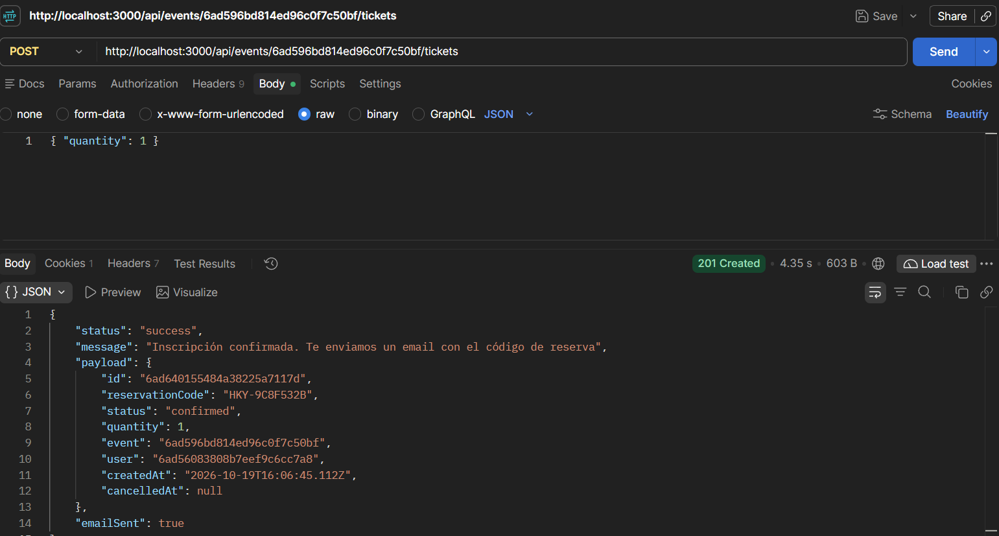

**2. Email de confirmación recibido:** llega a la casilla de prueba con el evento, la fecha, el lugar y el mismo código de reserva.

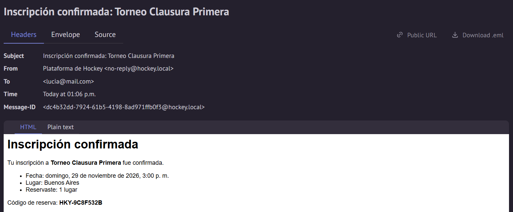

**3. Inscripción duplicada → 409:** Lucía ya tiene un ticket activo para ese evento.

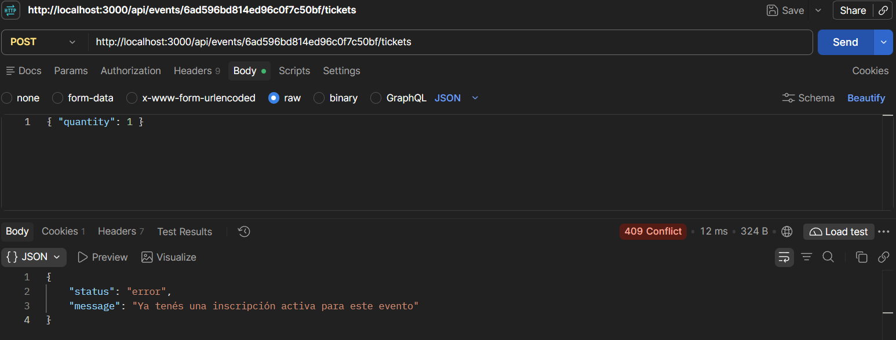

**4. Inscripción sin sesión → 401.**

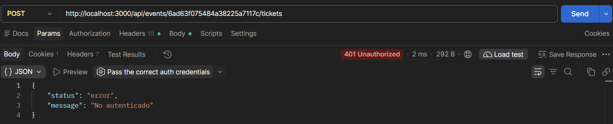

**5. Evento inexistente → 404.**

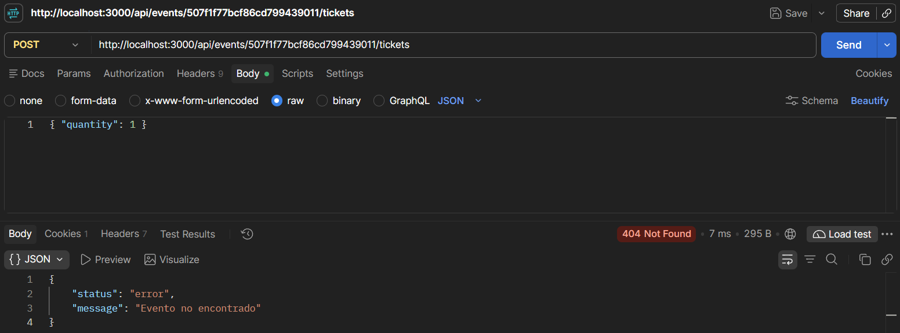

**6. Evento cancelado → 409:** la Clínica de juego aéreo está cancelada y no admite inscripciones.


**7. Sin cupo suficiente → 409:** Sofía ocupó los 2 lugares de la clínica; la respuesta lo explica.


**8. Cancelar el ticket de otro usuario → 403:** Lucía intenta cancelar el ticket de Sofía.

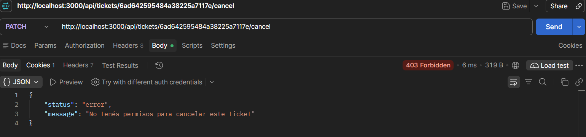

**9. Cancelación propia → 200:** Sofía cancela su ticket; queda `cancelled` con `cancelledAt` y no se borra.

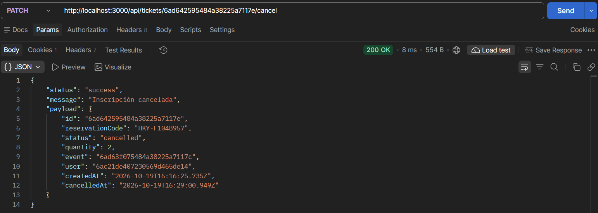

**10. Cupo liberado → 201:** con el ticket de Sofía cancelado, Lucía ahora sí puede reservar los 2 lugares.

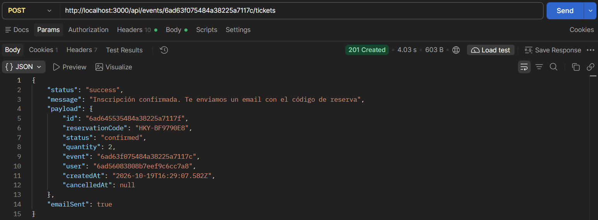

**11. Mis tickets → 200:** solo los tickets de Lucía, con `title`, `date` y `location` del evento.

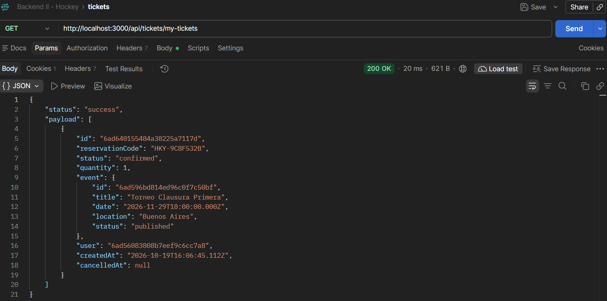

**12. Inscriptos de un evento como `user` → 403.**

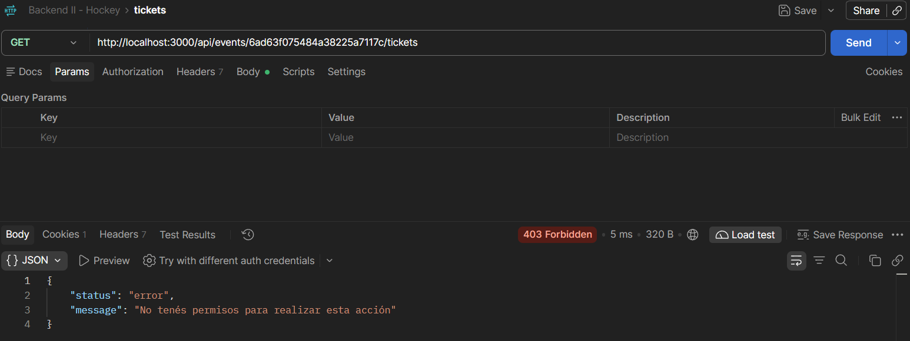

**13. Inscriptos como `organizer` de otro evento → 403:** Raul intenta ver los inscriptos del torneo de Ana.

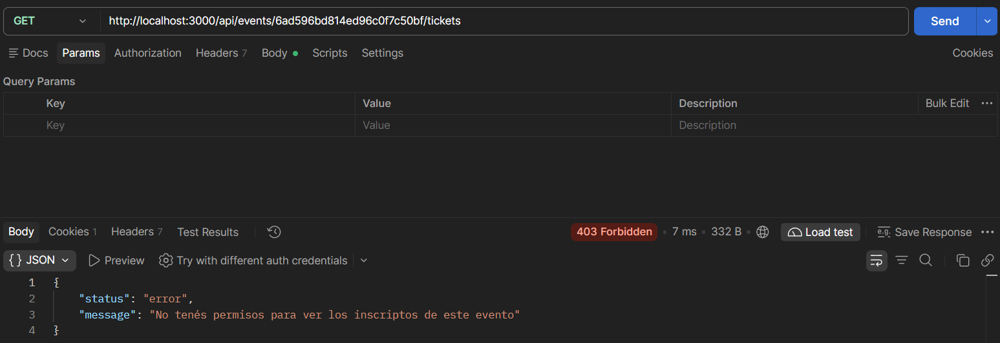

**14. Inscriptos como `organizer` dueño → 200:** Raul ve el resumen de cupo de su clínica (2 reservados de 2; el ticket cancelado de Sofía no cuenta) y los inscriptos.

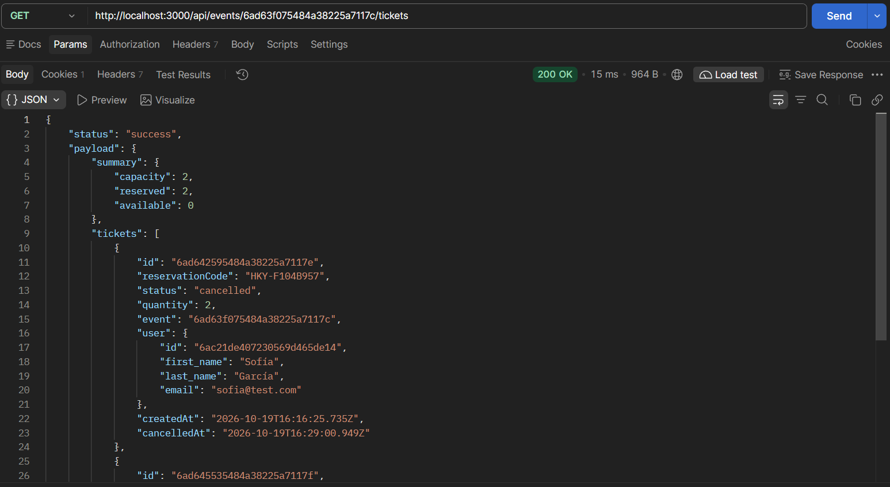

### Eventos y lógica de negocio (Pre-entrega 6)

Usuarios de prueba: **Lucía** (`user`), **Raul** (`organizer`) y **Ana** (`admin`). Categorías cargadas: `torneo`, `clinica` y `workshop`.

**1. Crear evento con rol `user` → 403:** Lucía está autenticada, pero su rol no puede crear eventos.

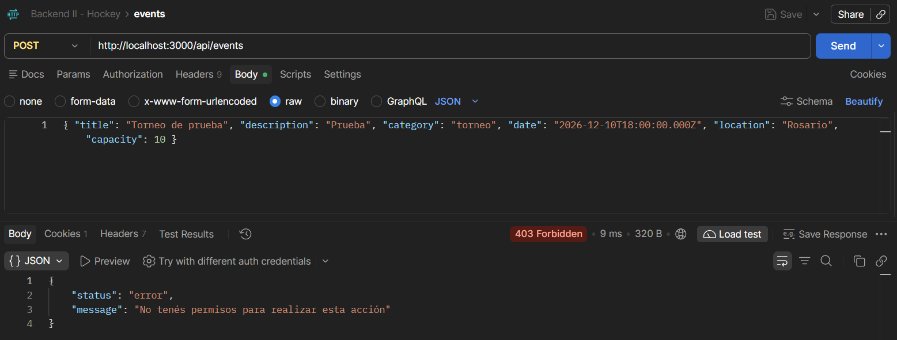

**2. Crear evento con fecha pasada → 400:** la regla de fecha futura se valida en el service.

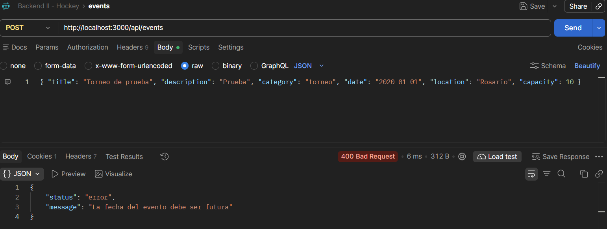

**3. Crear evento con `capacity: 0` → 400:** el cupo tiene que ser un entero mayor a cero.

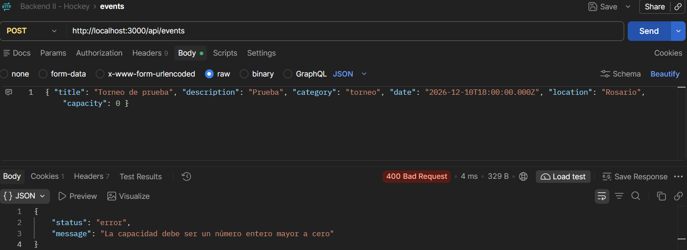

**4. El organizer modifica su propio evento → 200:** Raul cambia el cupo del Torneo Apertura Sub 16.

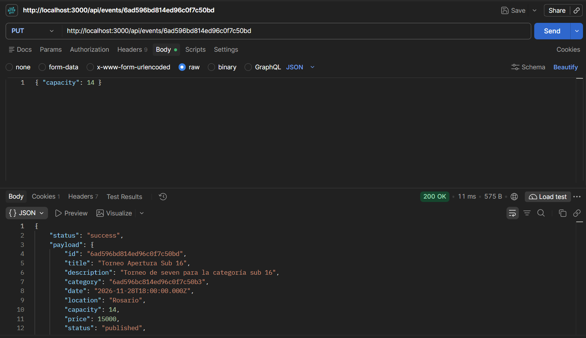

**5. El organizer modifica un evento ajeno → 403:** Raul intenta editar el Torneo Clausura Primera, que creó Ana.

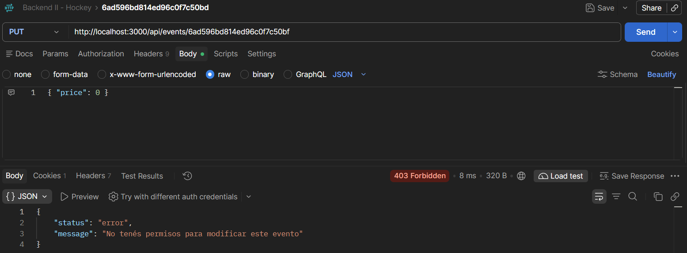

**6. El admin modifica el evento de otro organizador → 200:** Ana edita el torneo de Raul; el `organizer` sigue siendo Raul.

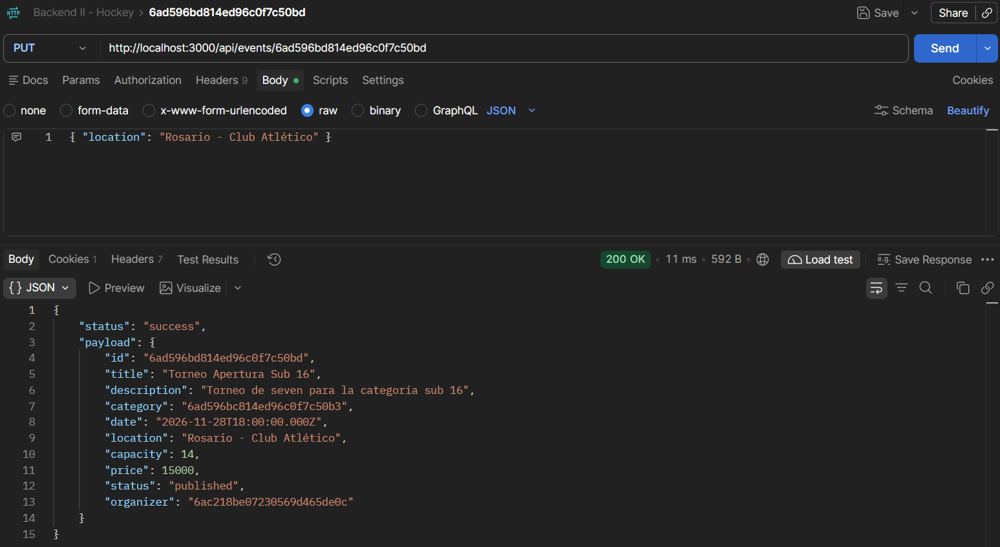

**7. Cambiar el estado de un evento cancelado → 409:** la Clínica de juego aéreo se canceló con `PATCH /status` y ya no puede volver a publicarse.

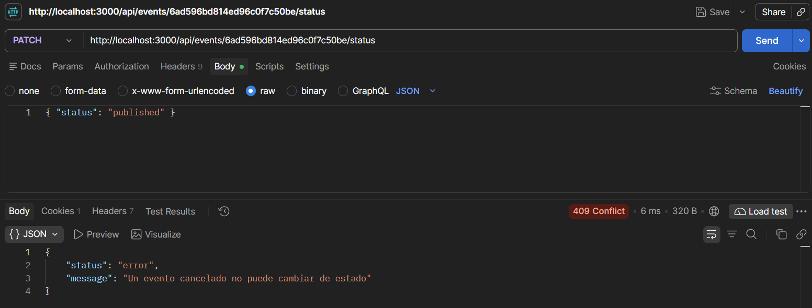

**8. Listado con filtros `?status=published&category=workshop&page=2&limit=5` → 200:** hay 7 workshops publicados, la página 2 trae los últimos 2 (se ve el final de la respuesta con `page`, `limit`, `total` y `totalPages`).

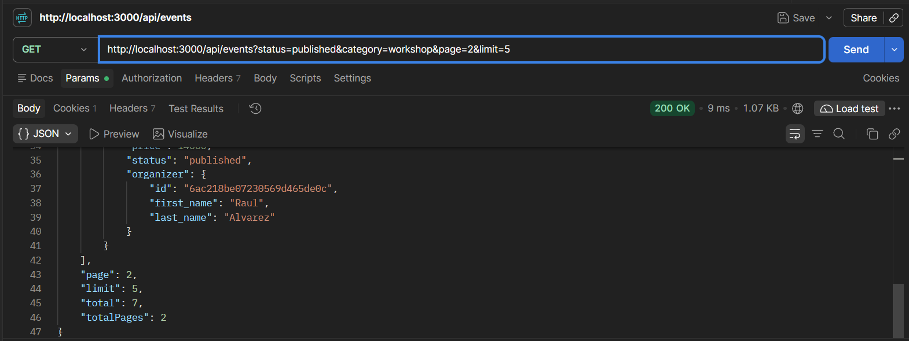

**9. Evento inexistente → 404.**

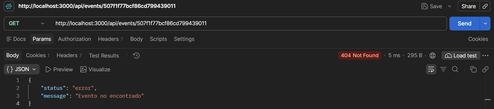

### Roles y autorización (Pre-entrega 5)

Usuarios de prueba: **Lucía** (`user`), **Raul** (`organizer`) y **Ana** (`admin`, el primer admin asignado en la base).

**1. `POST /api/events` con rol `user` → 403:** está autenticada, pero su rol no tiene permiso para crear eventos.


**2. `POST /api/events` con rol `organizer` → 201:** el evento se crea activo y el `organizer` es el usuario logueado (su `id` coincide con el de Raul en la captura 4).


**3. Ruta administrativa `GET /api/users` con rol `organizer` → 403.**


**4. Ruta administrativa `GET /api/users` con rol `admin` → 200:** lista de usuarios con su rol y sin contraseñas.


### Flujo completo con Passport (Pre-entrega 4)

Mismas rutas y respuestas que en la Pre-entrega 3, ahora resueltas por las estrategias de Passport.

**1. Registro (estrategia `register`):** el email llega como `"Lucia@Mail.com "` y se guarda normalizado, con rol `user` y sin la contraseña en la respuesta.


**2. Login (estrategia `login`):** responde `200` y el controller setea la cookie `currentUser` con `Max-Age=3600`, `HttpOnly` y `SameSite=Lax`.


**3. `/current` con la cookie (estrategia `current`):** `200` con `{ id, email, role }`. El `id` es el mismo del registro.


**4. Logout:** borra la cookie y responde `200 Sesión cerrada` (no pasa por Passport).


**5. `/current` después del logout:** sin la cookie, la estrategia `current` falla y la ruta responde `401 No autenticado`.


### Login, current y logout (Pre-entrega 3)

**Login:** responde `200 Login correcto` y setea la cookie `currentUser` con `Max-Age=3600`, `HttpOnly` y `SameSite=Lax` (sin `Secure` porque corre en desarrollo, por `http`).


**`/current` con la cookie:** responde `200` con `{ id, email, role }`, sin la contraseña. El `id` es el mismo del usuario registrado en la Pre-entrega 2.


**`/current` sin cookie:** después del logout la cookie ya no está, y la ruta protegida responde `401 No autenticado`.


### Registro (Pre-entrega 2)

**Registro exitoso en Postman:** el email llega como `"Ana@Mail.com "` y se guarda normalizado como `ana@mail.com`, con rol `user`. La respuesta no incluye la contraseña.


**Usuario guardado en MongoDB Compass:** el mismo usuario (`_id` `6ac503bc13597b7ed91711a8`, igual al `id` de la respuesta) tiene la contraseña hasheada con bcrypt (`$2b$10$...`), nunca en texto plano.


