# Plataforma de Torneos y Clínicas de Hockey

Proyecto final de Backend II (Coderhouse). API REST para gestionar torneos y clínicas de hockey sobre césped: usuarios, eventos, categorías e inscripciones.

Esta versión corresponde a la **Pre-entrega 5**: suma **roles y autorización**. Cada acción se valida según el rol del usuario (`user`, `organizer`, `admin`) y, cuando corresponde, según quién es el dueño del recurso, diferenciando **401** (sin sesión) de **403** (sin permiso). La autenticación sigue centralizada en estrategias de Passport.js con JWT en la cookie HTTP Only `currentUser`, igual que en la Pre-entrega 4.

## Versiones por entrega

Cada pre-entrega quedó en su propia rama, así se puede revisar el código tal como estaba en cada etapa. Cada rama incluye todo lo de las anteriores.

| Entrega | Rama | Qué suma |
| --- | --- | --- |
| Pre-entrega 1 | [`pre-entrega-1`](https://github.com/RaulAlvarezV/be2_proyecto_final/tree/pre-entrega-1) | Estructura base por capas (routes, controllers, services, repositories, DAO, models) |
| Pre-entrega 2 | [`pre-entrega-2`](https://github.com/RaulAlvarezV/be2_proyecto_final/tree/pre-entrega-2) | Registro seguro de usuarios con bcrypt, modelos Category y Registration |
| Pre-entrega 3 | [`pre-entrega-3`](https://github.com/RaulAlvarezV/be2_proyecto_final/tree/pre-entrega-3) | Login con JWT en la cookie `currentUser`, ruta `/current`, logout y tests automatizados |
| Pre-entrega 4 | [`pre-entrega-4`](https://github.com/RaulAlvarezV/be2_proyecto_final/tree/pre-entrega-4) | Autenticación centralizada en estrategias de Passport (register, login, current) |
| Pre-entrega 5 | [`pre-entrega-5`](https://github.com/RaulAlvarezV/be2_proyecto_final/tree/pre-entrega-5) | Roles y autorización: matriz de permisos, `authorizeRoles`, propiedad de eventos y rutas de administración |

Las capturas de cada entrega están en la sección [Evidencias](#evidencias).

## Temática

La plataforma permite que clubes y entrenadores publiquen **torneos** y **clínicas técnicas** de hockey, y que los jugadores se inscriban.

| Rol | Quién es | Qué va a poder hacer |
| --- | --- | --- |
| `admin` | Administración de la plataforma | Gestionar usuarios, categorías, eventos e inscripciones |
| `organizer` | Club, entrenador o academia | Crear y administrar sus torneos y clínicas |
| `user` | Jugador o jugadora | Consultar eventos e inscribirse |

Todo usuario nuevo se registra con rol `user`. El rol nunca se toma del body del registro.

### Entidades

| Modelo | Qué representa |
| --- | --- |
| `User` | Usuario de la plataforma: `first_name`, `last_name`, `email` (único), `password` (hash) y `role` (`user` por defecto; `user`, `organizer` o `admin`) |
| `Event` | Torneo o clínica: nombre, tipo (`torneo` / `clinica`), fecha, lugar, cupo, precio, estado, categoría y organizador |
| `Category` | Categoría de los eventos (por ejemplo Sub 14, Sub 16, Primera, Arqueras) |
| `Registration` | Inscripción de un usuario a un evento. Un usuario no puede inscribirse dos veces al mismo evento |

## Tecnologías

- Node.js y Express
- MongoDB + Mongoose (local o MongoDB Atlas)
- dotenv
- bcrypt (hash de contraseñas)
- jsonwebtoken (JWT)
- cookie-parser (lectura de la cookie de autenticación)
- Passport.js: `passport`, `passport-local` (registro y login) y `passport-jwt` (usuario actual)
- node:test (tests automatizados, incluido en Node)
- Módulos ESM (`import` / `export`)

Próximas entregas: inscripciones, Nodemailer.

## Roles y autorización

### Roles

| Rol | En la plataforma | Cómo se obtiene |
| --- | --- | --- |
| `user` | Jugador o jugadora | Por defecto en todo registro. El registro público **nunca** acepta `role` del body |
| `organizer` | Club, entrenador o academia | Lo asigna un `admin` con `PATCH /api/users/:uid/role` |
| `admin` | Administración de la plataforma | El primero se asigna a mano en la base (ver abajo); después, otro admin con la misma ruta |

Los roles y la matriz están definidos en **`src/config/permissions.js`** (congelados con `Object.freeze`), y el modelo `User` toma de ahí el `enum` y el valor por defecto.

### Matriz de permisos

| Acción | Ruta | user | organizer | admin |
| --- | --- | --- | --- | --- |
| Consultar eventos publicados | `GET /api/events` | ✅ | ✅ | ✅ (pública, sin login) |
| Ver su propia sesión | `GET /api/sessions/current` | ✅ | ✅ | ✅ |
| Crear eventos | `POST /api/events` | ❌ 403 | ✅ | ✅ |
| Modificar / cancelar eventos propios | `PUT /api/events/:eid` · `PATCH /api/events/:eid/cancel` | ❌ 403 | ✅ | ✅ |
| Modificar / cancelar cualquier evento | (las mismas rutas) | ❌ 403 | ❌ 403 | ✅ |
| Ver todos los usuarios | `GET /api/users` | ❌ 403 | ❌ 403 | ✅ |
| Cambiar el rol de un usuario | `PATCH /api/users/:uid/role` | ❌ 403 | ❌ 403 | ✅ |

### 401 vs 403

| Código | Significa | Cuándo | Respuesta |
| --- | --- | --- | --- |
| **401** Unauthorized | **No está autenticado**: la API no sabe quién es | Sin cookie, token vencido, alterado o inválido | `{ "status": "error", "message": "No autenticado" }` (o `"Token inválido o expirado"`) |
| **403** Forbidden | **Está autenticado pero no tiene permiso**: la API sabe quién es y bloquea la acción | Un `user` crea un evento, un `organizer` entra a una ruta de admin o modifica un evento ajeno | `{ "status": "error", "message": "No tenés permisos para realizar esta acción" }` |

Ejemplo con `POST /api/events`: sin login → **401**; logueado como `user` → **403**; como `organizer` o `admin` → **201**.

### Middlewares

| Middleware | Archivo | Qué hace |
| --- | --- | --- |
| `auth` | `middlewares/auth.middleware.js` | Autenticación: estrategia `current` de Passport. Lee el JWT de la cookie, valida y carga `req.user`. **401** si no hay sesión válida |
| `authorizeRoles(...roles)` | `middlewares/authorize.middleware.js` | Autorización por rol: recibe los roles permitidos y compara contra `req.user.role`. **403** si no coincide (y 401 si no hay `req.user`) |
| `authorizeEventOwnerOrAdmin` | `middlewares/authorize.middleware.js` | Autorización por propiedad: deja pasar al organizer **dueño** del evento o al `admin`. **403** para un organizer ajeno, **404** si el evento no existe. Deja el evento en `req.event` |

Las rutas aplican los middlewares en orden, usando la matriz (ningún rol queda escrito suelto en las rutas):

```javascript
router.post("/", auth, authorizeRoles(...PERMISSIONS.CREATE_EVENT), createEvent);
router.put("/:eid", auth, authorizeRoles(...PERMISSIONS.MANAGE_EVENT), authorizeEventOwnerOrAdmin, updateEvent);
router.use(auth, authorizeRoles(...PERMISSIONS.MANAGE_USERS)); // todas las rutas de /api/users
```

**autenticación (401) → rol (403) → propiedad (403) → controller**

El rol se lee de la base en cada petición (la estrategia `current` busca al usuario por el id del token), así que si un admin cambia el rol de alguien, el cambio aplica en su próxima petición, sin volver a loguearse.

### Crear el primer admin

El registro público siempre crea usuarios `user`. Para el **primer** admin (una sola vez):

1. Registrarse con `POST /api/sessions/register`.
2. En MongoDB Compass → base `be2_proyecto_final` → colección `users` → editar el documento y cambiar `"role": "user"` por `"role": "admin"`.
3. Volver a hacer login.

Desde ahí, ese admin convierte a otros usuarios en `organizer` (o `admin`) con `PATCH /api/users/:uid/role`, sin tocar la base. Un admin no puede cambiar su propio rol, para que la plataforma nunca se quede sin administradores.

## Autenticación con Passport

Toda la autenticación está centralizada en **`src/config/passport.config.js`**. `app.js` solo llama a `initializePassport()` y `passport.initialize()`.

| Estrategia | Tipo | Qué hace | Ruta que la usa |
| --- | --- | --- | --- |
| `register` | `passport-local` | Valida los campos, normaliza el email, controla duplicados, hashea la contraseña con bcrypt y crea el usuario con rol `user` | `POST /api/sessions/register` |
| `login` | `passport-local` | Busca al usuario por email y compara la contraseña con bcrypt. Si algo no coincide responde `Credenciales inválidas` | `POST /api/sessions/login` |
| `current` | `passport-jwt` | Lee el JWT de la cookie `currentUser`, verifica firma y vencimiento (algoritmo `HS256` fijado por el servidor) y busca al usuario por el id del token | `GET /api/sessions/current` |

- **Las rutas solo delegan:** `router.post("/login", passportCall("login"), login)`. `passportCall` ejecuta `passport.authenticate(estrategia, { session: false })` y, si la autenticación falla, responde en JSON con el código que indica la estrategia (400, 401 o 409), así el contrato de la API no cambia.
- **El JWT y la cookie los genera el controller**, no Passport: la estrategia `login` solo valida las credenciales y deja `{ id, email, role }` en `req.user`.
- **El logout no pasa por Passport:** solo borra la cookie.
- **`session: false`:** la sesión la representa el JWT en la cookie, Passport no guarda sesiones en el servidor.

### Preparado para proveedores externos (Google, GitHub)

`initializePassport()` registra cada estrategia con una función propia. Para sumar, por ejemplo, login con GitHub:

1. Instalar la estrategia (`npm install passport-github2`).
2. Agregar en `passport.config.js` una función `githubStrategy(repository)` que busque o cree el usuario local con los datos que devuelve GitHub, y llamarla dentro de `initializePassport()`.
3. Sumar al `.env` sus credenciales (`GITHUB_CLIENT_ID`, `GITHUB_CLIENT_SECRET`, `GITHUB_CALLBACK_URL`) y las rutas de inicio y callback en `sessions.router.js`, que también generan el JWT propio de la API en el controller.

No hace falta tocar `app.js`: ya inicializa Passport y registra todo lo que esté en `initializePassport()`.

## Instalación

```bash
git clone https://github.com/RaulAlvarezV/be2_proyecto_final.git
cd be2_proyecto_final
npm install
```

## Variables de entorno

Copiar `.env.example` como `.env` y completar los valores:

```
PORT=8080
NODE_ENV=development
MONGO_URL=mongodb://localhost:27017/be2_proyecto_final
JWT_SECRET=
JWT_EXPIRES_IN=1h
```

| Variable | Descripción |
| --- | --- |
| `PORT` | Puerto del servidor (por defecto 8080) |
| `NODE_ENV` | Entorno (`development` / `production`). En `production` la cookie se envía solo por HTTPS (`secure`) |
| `MONGO_URL` | Cadena de conexión a MongoDB (local o Atlas) |
| `JWT_SECRET` | Clave para firmar y verificar los JWT. **Obligatoria**: sin ella el servidor no arranca. Usar una clave larga y aleatoria |
| `JWT_EXPIRES_IN` | Duración del token (por defecto `1h`) |

El archivo `.env` no se sube al repositorio.

## Ejecución

```bash
# desarrollo (se reinicia al guardar cambios)
npm run dev

# producción
npm start

# tests automatizados
npm test
```

## Estructura de carpetas

```
src/
├── app.js                       # configura Express (json, cookie-parser, Passport y rutas), no levanta el servidor
├── server.js                    # valida JWT_SECRET, carga la app, levanta el servidor y conecta la base
├── config/
│   ├── env.js                   # variables de entorno con dotenv
│   ├── db.js                    # conexión a MongoDB
│   ├── cookie.js                # nombre y opciones de la cookie currentUser
│   ├── permissions.js           # roles y matriz de permisos
│   └── passport.config.js       # estrategias register, login y current (initializePassport)
├── routes/
│   ├── health.router.js
│   ├── events.router.js         # públicas, crear (rol) y modificar/cancelar (rol + propiedad)
│   ├── sessions.router.js       # las rutas delegan en las estrategias de Passport
│   └── users.router.js          # rutas administrativas (solo admin)
├── controllers/
│   ├── health.controller.js
│   ├── events.controller.js
│   ├── sessions.controller.js   # responde, genera el token y maneja la cookie
│   └── users.controller.js
├── services/
│   ├── events.service.js        # reglas de eventos: fecha futura, campos permitidos, cancelados
│   └── users.service.js         # listado sin contraseñas y cambio de rol
├── dto/
│   └── user.dto.js              # datos públicos del usuario (sin contraseña)
├── repositories/
│   ├── events.repository.js
│   └── users.repository.js
├── dao/
│   ├── events.dao.js
│   └── users.dao.js
├── models/
│   ├── User.js
│   ├── Event.js
│   ├── Category.js
│   └── Registration.js
├── middlewares/
│   ├── auth.middleware.js       # autenticación: passportCall y auth (estrategia current) → 401
│   ├── authorize.middleware.js  # autorización: authorizeRoles → 403 y authorizeEventOwnerOrAdmin
│   └── error.middleware.js      # rutas no encontradas y manejo global de errores
└── utils/
    ├── jwt.js                   # generateToken y verifyToken
    ├── hash.js                  # createHash e isValidPassword (bcrypt)
    └── errors.js                # error con código de estado (AppError)
tests/
├── authorization.test.js        # matriz, authorizeRoles, propiedad de eventos y administración de usuarios
├── passport.strategies.test.js  # estrategias register, login y current con un repository falso (sin MongoDB)
└── jwt.test.js                  # helper de JWT
```

Flujo del login y de una petición protegida:

```
POST /api/sessions/login
  → sessions.router.js
  → passportCall("login")        (estrategia login de passport.config.js → req.user = { id, email, role })
  → sessions.controller.js       (genera el JWT y setea la cookie currentUser)

GET /api/sessions/current
  → sessions.router.js
  → auth = passportCall("current")  (estrategia current: cookie → JWT → usuario → req.user)
  → sessions.controller.js          (responde { id, email, role })
```

## Rutas

| Método | Ruta | Descripción | Acceso |
| --- | --- | --- | --- |
| GET | `/api/health` | Verifica que el servidor esté activo | Público |
| GET | `/api/events` | Torneos y clínicas publicados (activos) | Público |
| POST | `/api/events` | Crear un torneo o clínica | `organizer`, `admin` |
| PUT | `/api/events/:eid` | Modificar un evento | `organizer` dueño, `admin` |
| PATCH | `/api/events/:eid/cancel` | Cancelar un evento | `organizer` dueño, `admin` |
| GET | `/api/users` | Listar todos los usuarios (sin contraseñas) | `admin` |
| PATCH | `/api/users/:uid/role` | Cambiar el rol de un usuario | `admin` |
| POST | `/api/sessions/register` | Registro seguro de usuario | Público |
| POST | `/api/sessions/login` | Inicio de sesión: genera el JWT y lo guarda en la cookie `currentUser` | Público |
| GET | `/api/sessions/current` | Datos del usuario autenticado | **Requiere cookie** |
| POST | `/api/sessions/logout` | Cierra la sesión borrando la cookie | Público |

### `POST /api/events`

Requiere sesión y rol `organizer` o `admin`. El organizador del evento es siempre el usuario logueado y todo evento nace `active` (se ignoran `organizer` y `status` del body).

Request:

```json
{ "name": "Torneo Apertura Sub 16", "type": "torneo", "date": "2026-11-15T15:00:00.000Z", "place": "Club Atlético", "capacity": 12, "price": 15000 }
```

Response `201`:

```json
{ "status": "success", "payload": { "id": "6690...", "name": "Torneo Apertura Sub 16", "type": "torneo", "date": "2026-11-15T15:00:00.000Z", "place": "Club Atlético", "capacity": 12, "price": 15000, "status": "active", "organizer": "665f2a..." } }
```

| Código | Cuándo |
| --- | --- |
| `401` | Sin sesión |
| `403` | Rol `user` |
| `400` | Fecha pasada o inválida, faltan campos, `type` distinto de `torneo`/`clinica`, cupo menor a 1 o precio negativo |

### `PUT /api/events/:eid` y `PATCH /api/events/:eid/cancel`

Requieren sesión, rol `organizer` o `admin` y ser el **dueño** del evento (el admin puede cualquiera). `PUT` modifica solo `name`, `description`, `type`, `date`, `place`, `capacity`, `price` y `category`.

| Código | Cuándo |
| --- | --- |
| `200` | Modificado / cancelado |
| `401` | Sin sesión |
| `403` | Rol `user`, o `organizer` que no es el dueño del evento: `"No tenés permisos para modificar este evento"` |
| `404` | El evento no existe |
| `409` | El evento ya está cancelado (no se modifica ni se vuelve a cancelar) |
| `400` | Sin campos válidos, fecha pasada o datos inválidos |

### `GET /api/users` y `PATCH /api/users/:uid/role` (solo admin)

`GET /api/users` → `200` con la lista de usuarios (`id`, `first_name`, `last_name`, `email`, `role`), sin contraseñas.

`PATCH /api/users/:uid/role` con body `{ "role": "organizer" }` → `200` con el usuario actualizado.

| Código | Cuándo |
| --- | --- |
| `401` | Sin sesión |
| `403` | Rol `user` u `organizer` |
| `400` | Rol inválido (valores posibles: `user`, `organizer`, `admin`) |
| `404` | El usuario no existe |
| `409` | Un admin intenta cambiar su propio rol |

### `POST /api/sessions/register`

| Campo | Tipo | Reglas |
| --- | --- | --- |
| `first_name` | texto | Obligatorio, no vacío |
| `last_name` | texto | Obligatorio, no vacío |
| `email` | texto | Obligatorio, formato válido, único. Se guarda sin espacios y en minúsculas |
| `password` | texto | Obligatorio, mínimo 8 caracteres, no puede ser solo espacios. Se guarda hasheada con bcrypt |

Request:

```json
{ "first_name": "Ana", "last_name": "Pérez", "email": "Ana@Mail.com ", "password": "Secreta123" }
```

Response `201`:

```json
{ "status": "success", "payload": { "id": "665f2a...", "first_name": "Ana", "last_name": "Pérez", "email": "ana@mail.com", "role": "user" } }
```

| Código | Mensaje | Cuándo |
| --- | --- | --- |
| `400` | `Faltan campos obligatorios` | Falta algún campo |
| `400` | `Formato de email inválido` | Email mal escrito |
| `400` | `La contraseña debe tener al menos 8 caracteres` | Contraseña corta |
| `400` | `La contraseña no puede estar vacía` | Contraseña de solo espacios |
| `400` | `Los campos deben ser texto` | Algún campo no es texto |
| `400` | `El nombre y el apellido no pueden estar vacíos` | Nombre o apellido con solo espacios |
| `409` | `El email ya está registrado` | Email repetido (aunque cambien mayúsculas o espacios) |

### `POST /api/sessions/login`

Request:

```json
{ "email": "ana@mail.com", "password": "Secreta123" }
```

Response `200` (además setea la cookie `currentUser`):

```json
{ "status": "success", "message": "Login correcto" }
```

La cookie `currentUser` guarda el JWT con estas opciones:

| Opción | Valor | Para qué |
| --- | --- | --- |
| `httpOnly` | `true` | JavaScript del navegador no puede leerla (protege de XSS) |
| `sameSite` | `"lax"` | No se envía en peticiones que vienen de otros sitios (CSRF) |
| `maxAge` | `3600000` | Dura 1 hora |
| `secure` | `true` solo en producción | Solo viaja por HTTPS |

El JWT se firma con `JWT_SECRET`, vence según `JWT_EXPIRES_IN` y su payload tiene **solo** `{ id, email, role }`: nunca la contraseña. El token no se devuelve en el body.

| Código | Mensaje | Cuándo |
| --- | --- | --- |
| `400` | `Email y contraseña son obligatorios` | Falta el email o la contraseña |
| `401` | `Credenciales inválidas` | El email no existe **o** la contraseña no coincide. Es el mismo mensaje a propósito, para no revelar qué dato falló |

### `GET /api/sessions/current`

Protegida por el middleware `auth`, que ejecuta la **estrategia `current` de Passport**: lee la cookie `currentUser`, verifica el JWT, busca al usuario por el id del token y deja `{ id, email, role }` en `req.user`.

Response `200` (con la cookie):

```json
{ "status": "success", "payload": { "id": "665f2a...", "email": "ana@mail.com", "role": "user" } }
```

| Código | Mensaje | Cuándo |
| --- | --- | --- |
| `401` | `No autenticado` | No llega la cookie (sin login o después del logout) |
| `401` | `Token inválido o expirado` | El token fue alterado, está mal formado, vencido o firmado con otra clave |

### `POST /api/sessions/logout`

Borra la cookie `currentUser`. Response `200`:

```json
{ "status": "success", "message": "Sesión cerrada" }
```

### Otras rutas

`GET /api/health` → `200`

```json
{ "status": "ok", "message": "Servidor activo" }
```

`GET /api/events` → `200` (solo eventos activos)

```json
{ "status": "success", "payload": [ { "id": "6690...", "name": "Torneo Apertura Sub 16", "status": "active", "...": "..." } ] }
```

Ruta inexistente → `404`

```json
{ "status": "error", "message": "Ruta no encontrada" }
```

## Cómo probar el flujo completo

En **Postman** (guarda y envía la cookie automáticamente), con el servidor en marcha:

1. **POST** `http://localhost:8080/api/sessions/register` con el body de ejemplo → `201`.
2. **POST** `http://localhost:8080/api/sessions/login` con email y contraseña → `200`. En la pestaña **Cookies** de la respuesta aparece `currentUser` (HttpOnly).
3. **GET** `http://localhost:8080/api/sessions/current` → `200` con `{ id, email, role }`.
4. **POST** `http://localhost:8080/api/sessions/logout` → `200 Sesión cerrada`.
5. **GET** `/api/sessions/current` otra vez → `401 No autenticado`.

Para ver los errores del login: repetir el paso 2 con un email que no existe y después con una contraseña incorrecta. Las dos respuestas son iguales: `401 Credenciales inválidas`.

### Probar roles y autorización

Con un usuario de cada rol (el primer admin se crea como se explica en "Crear el primer admin"; los organizer los asigna el admin):

1. Login como `user` → **POST** `/api/events` → `403`.
2. Login como `admin` → **PATCH** `/api/users/<id del user>/role` con `{ "role": "organizer" }` → `200`.
3. Login como ese `organizer` → **POST** `/api/events` → `201`.
4. Como `organizer` → **GET** `/api/users` → `403`. Como `admin` → `200`.
5. Con otro `organizer` → **PUT** `/api/events/<id del evento del primero>` → `403`.
6. Sin cookie (después del logout) → cualquier ruta privada → `401`.

## Tests automatizados

```bash
npm test
```

37 tests con `node:test` (incluido en Node, sin dependencias extra). No necesitan MongoDB: las estrategias, los middlewares y los services reciben **repositorios falsos en memoria**, aprovechando la inyección de dependencias.

| Archivo | Qué prueba |
| --- | --- |
| `tests/authorization.test.js` | **Matriz** (y que no se pueda modificar en tiempo de ejecución). **authorizeRoles:** 401 sin sesión, 403 sin permiso, rutas admin solo para admin, fail closed sin roles. **Propiedad:** dueño, organizer ajeno 403, admin, 404, 401 y errores de la base. **Eventos:** organizer de la sesión, fecha futura, cancelado no se modifica, listado de activos. **Usuarios:** sin contraseñas, rol inválido 400, propio rol 409, inexistente 404 |
| `tests/passport.strategies.test.js` | **register:** éxito sin contraseña en la respuesta, hash bcrypt, rol ignorado, duplicado (409), campos faltantes, inválidos o de solo espacios (400). **login:** éxito con `{ id, email, role }` y el mismo 401 para email inexistente y contraseña incorrecta. **current:** token válido, sin cookie, alterado, mal formado, vencido, de otra clave, sin firma (`alg: none`) y usuario inexistente |
| `tests/jwt.test.js` | Helper de JWT: payload, expiración y token alterado |

## Evidencias

### Roles y autorización (Pre-entrega 5)

Usuarios de prueba: **Lucía** (`user`), **Raul** (`organizer`) y **Ana** (`admin`, el primer admin asignado en la base).

**1. `POST /api/events` con rol `user` → 403:** está autenticada, pero su rol no tiene permiso para crear eventos.

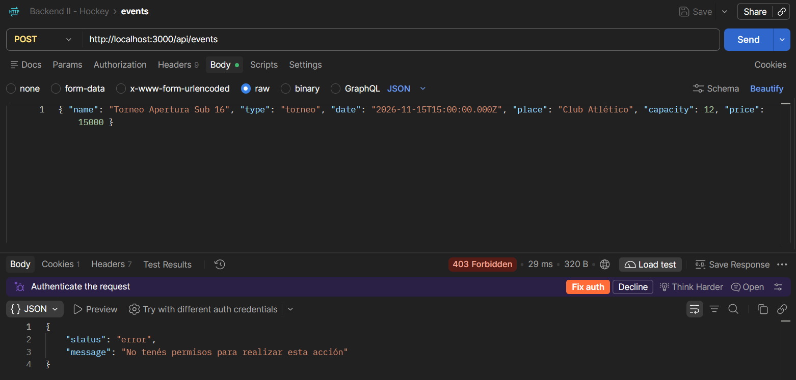

**2. `POST /api/events` con rol `organizer` → 201:** el evento se crea activo y el `organizer` es el usuario logueado (su `id` coincide con el de Raul en la captura 4).

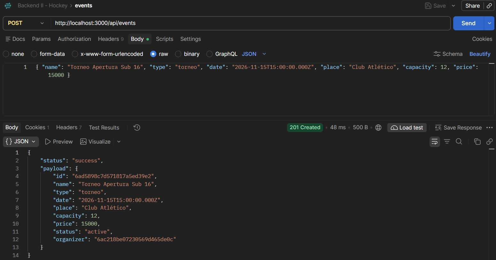

**3. Ruta administrativa `GET /api/users` con rol `organizer` → 403.**

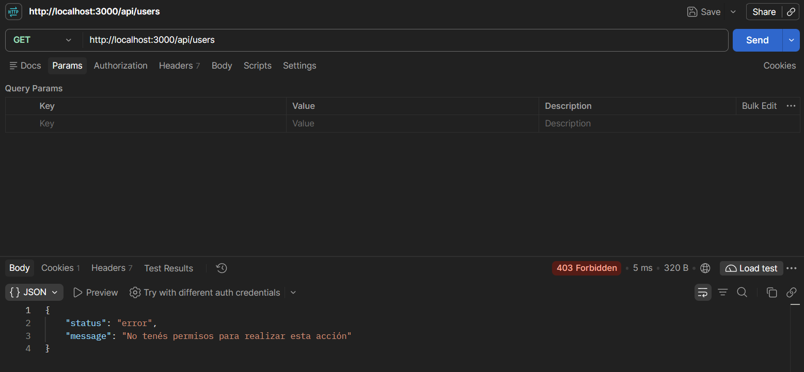

**4. Ruta administrativa `GET /api/users` con rol `admin` → 200:** lista de usuarios con su rol y sin contraseñas.

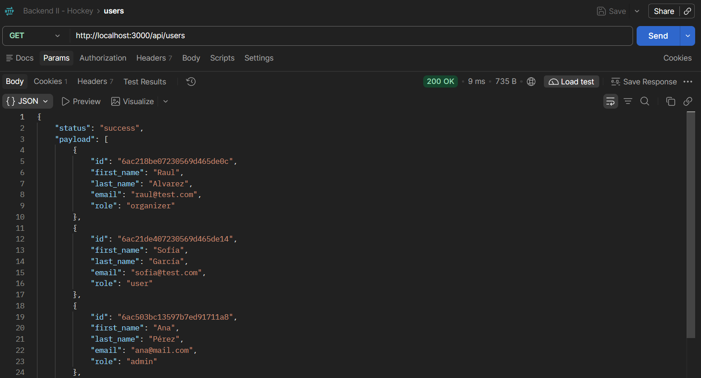

### Flujo completo con Passport (Pre-entrega 4)

Mismas rutas y respuestas que en la Pre-entrega 3, ahora resueltas por las estrategias de Passport.

**1. Registro (estrategia `register`):** el email llega como `"Lucia@Mail.com "` y se guarda normalizado, con rol `user` y sin la contraseña en la respuesta.

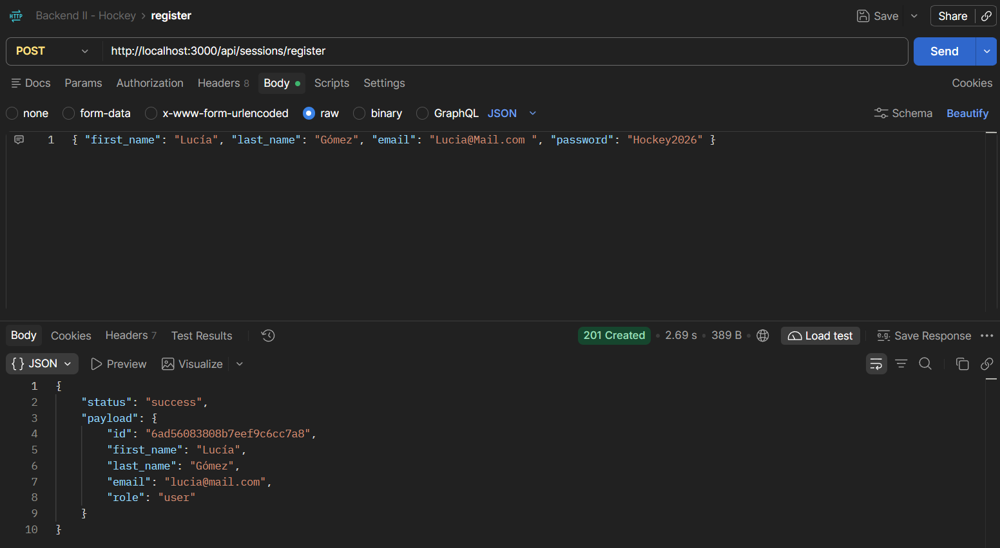

**2. Login (estrategia `login`):** responde `200` y el controller setea la cookie `currentUser` con `Max-Age=3600`, `HttpOnly` y `SameSite=Lax`.

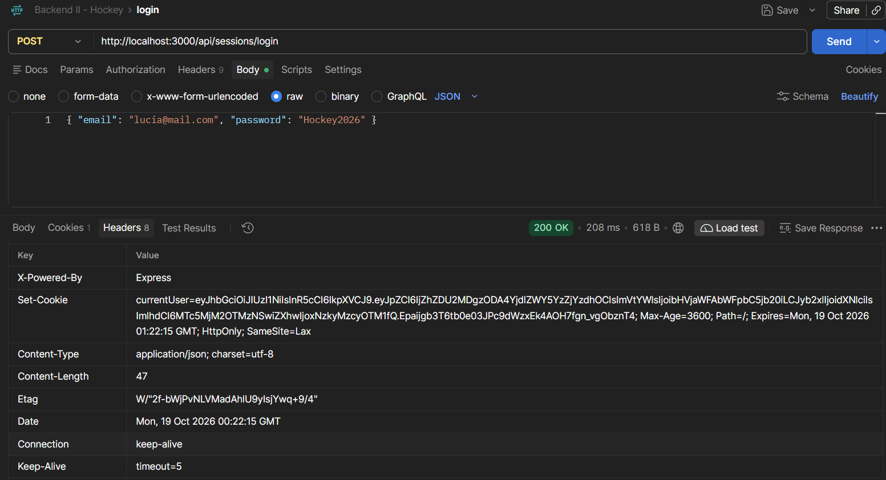

**3. `/current` con la cookie (estrategia `current`):** `200` con `{ id, email, role }`. El `id` es el mismo del registro.

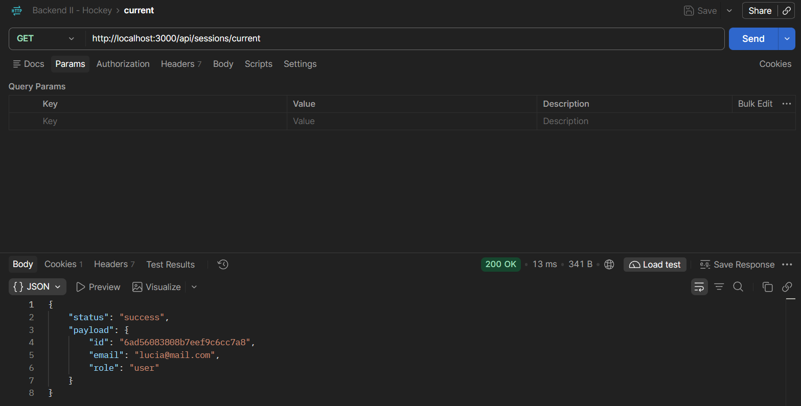

**4. Logout:** borra la cookie y responde `200 Sesión cerrada` (no pasa por Passport).

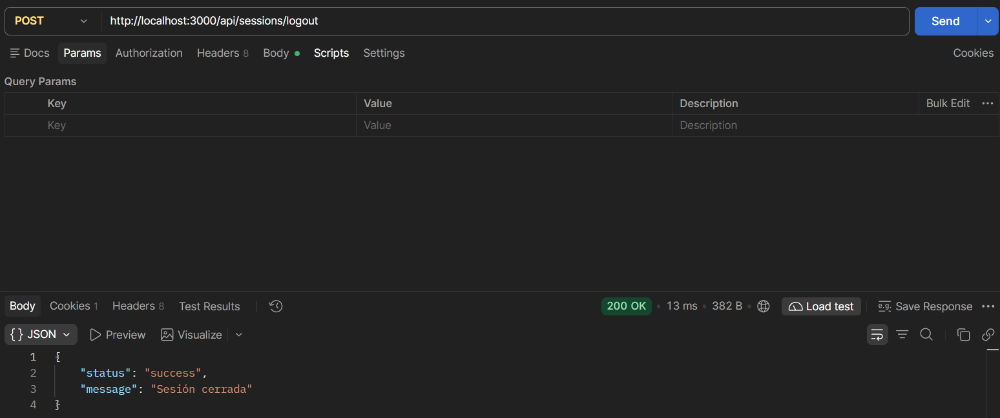

**5. `/current` después del logout:** sin la cookie, la estrategia `current` falla y la ruta responde `401 No autenticado`.

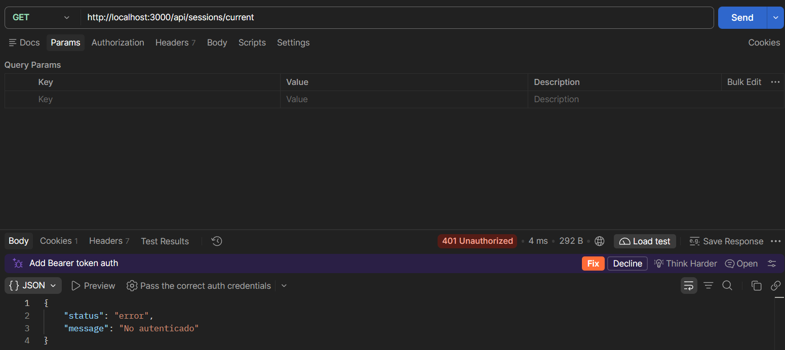

### Login, current y logout (Pre-entrega 3)

**Login:** responde `200 Login correcto` y setea la cookie `currentUser` con `Max-Age=3600`, `HttpOnly` y `SameSite=Lax` (sin `Secure` porque corre en desarrollo, por `http`).

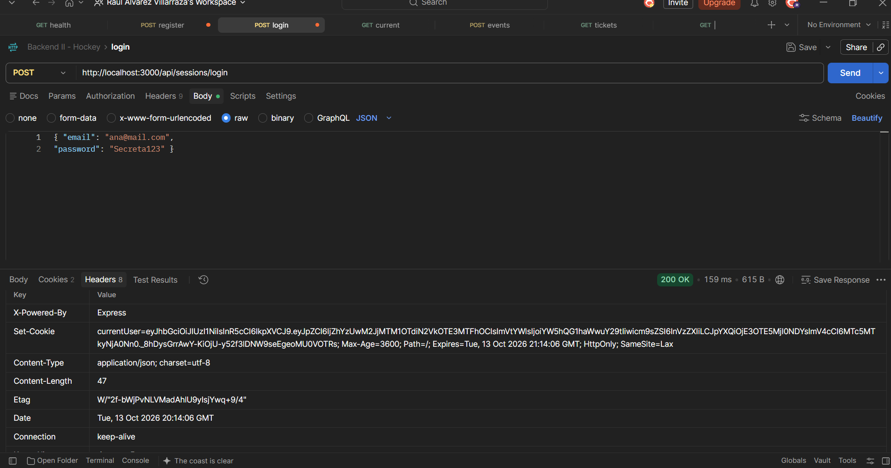

**`/current` con la cookie:** responde `200` con `{ id, email, role }`, sin la contraseña. El `id` es el mismo del usuario registrado en la Pre-entrega 2.

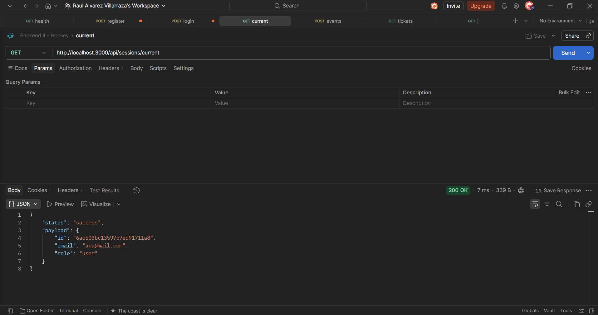

**`/current` sin cookie:** después del logout la cookie ya no está, y la ruta protegida responde `401 No autenticado`.

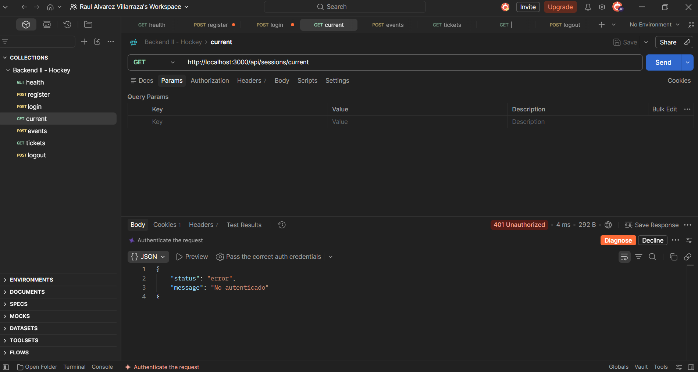

### Registro (Pre-entrega 2)

**Registro exitoso en Postman:** el email llega como `"Ana@Mail.com "` y se guarda normalizado como `ana@mail.com`, con rol `user`. La respuesta no incluye la contraseña.

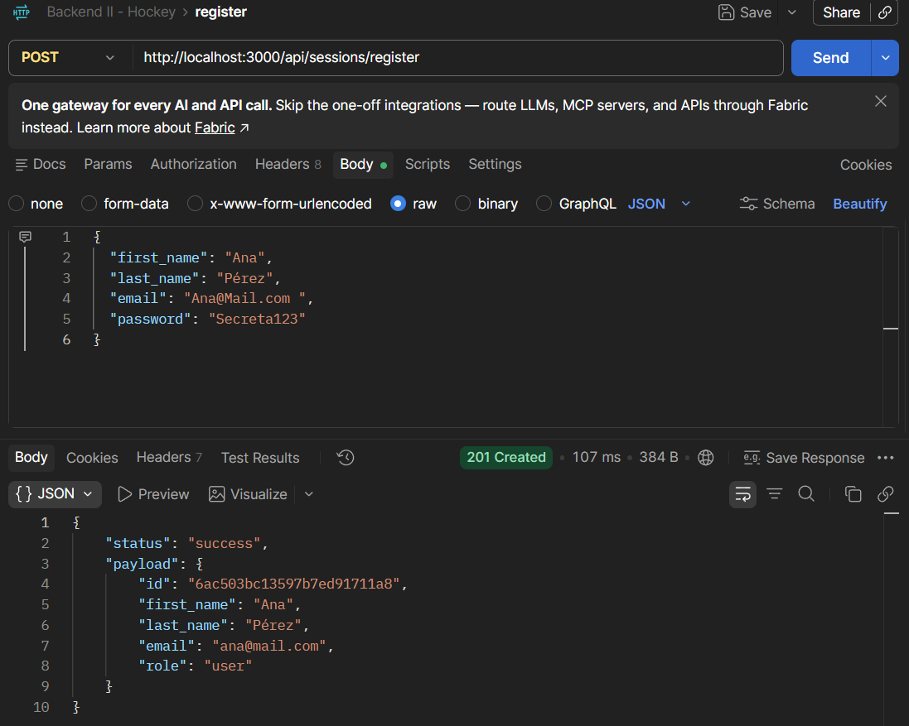

**Usuario guardado en MongoDB Compass:** el mismo usuario (`_id` `6ac503bc13597b7ed91711a8`, igual al `id` de la respuesta) tiene la contraseña hasheada con bcrypt (`$2b$10$...`), nunca en texto plano.

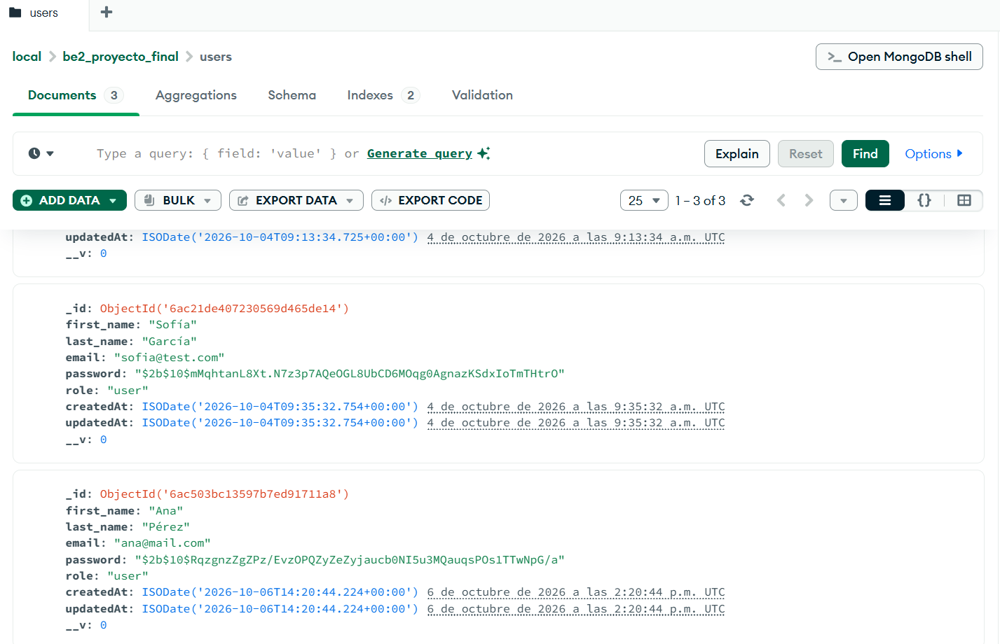
